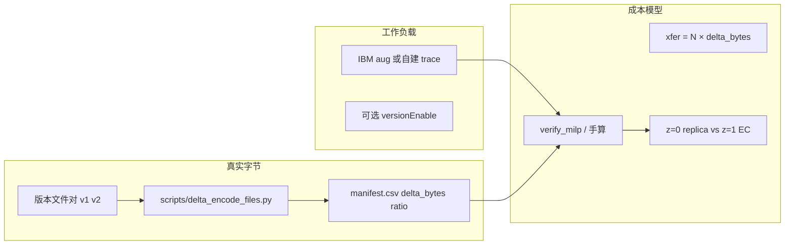

# 真实数据上的差分编码 + EC / MILP 实验流水线

## 1. 两层「真实数据」

| 层级 | 你仓库里已有 | 差分编码需要什么 |
|------|-------------|------------------|
| **A. 工作负载（何时、多大、哪区）** | SNIA IBM → `Data/*/IBMObjectStoreTrace*.mc.aug`（`timestamp, op, issue_region, obj_key, size`） | 足够驱动仿真 **时间线、区域、对象大小** |
| **B. 对象字节（delta 从哪来）** | **不在** `.aug` 文件里 | 必须另有 **文件版本对**（备份、Git、VM 镜像、用户自建数据集） |

Finesse / 可变粒度论文（`Fast_Variable-Grained_Resemblance_Data.pdf`）在 **有字节内容** 上做 Rabin 指纹 + VCDiff delta。  
SkyStore 仿真器当前对传输计费是 **`egress_cost × 整段 size`**，要体现差分优势，需要把 size 换成 **`|delta|` 或 `effective_xfer_bytes`**。

结论：**可以**用真实 trace 定 workload，用 **真实文件** 定 delta；二者通过 **manifest（清单）** 绑在一起。

---

## 2. 推荐实验路径（delta → 再 EC）



1. **采集真实版本对**（同一逻辑对象的两次快照）。
2. **`delta_encode_files.py`** 测 `|delta|` / `compression_ratio`（优先 zstd，无则提示安装）。
3. 写 **`manifest.csv`**：`logical_key, base_path, new_path, size_new, delta_bytes, delta_ratio`。
4. **Trace**：沿用 IBM T15–T79，或按 manifest 合成 PUT 行（size 用 `size_new`，传输模型用 `delta_ratio`）。
5. **EC**：仍用现有 `GurobiEc21MilpBuilder`；仅把 **placement egress** 中 replica 支路的字节数改为 `delta_ratio × V`（EC 两片仍可按半片满尺寸或再测 shard-delta）。
6. 与 **Tevict 基线**、**满尺寸 replica** 对比总 $storage + transfer$。

---

## 3. IBM trace 的重要限制

对 `Data/3reg/3reg/typeA/IBMObjectStoreTrace065Part0.typeA.mc.aug` 统计：**同一 `obj_key` 的多次 PUT = 0**。  
即当前 aug 轨迹是 **每对象一次写**，**不能**仅凭 trace 做 Finesse 式「对上一版本打 delta」。

可选补救：

- 使用 SNIA **原始** 轨迹里对同一 key 的覆盖写（若存在），再 `versionEnable` 生成 `*-versioned`；
- 或用 **manifest + 真实文件** 定义「逻辑上第二次 PUT」，在合成 trace 里插入第二行 PUT（size / xfer 用实测 delta）。

---

## 4. 数据集从哪找（除 IBM 外）

| 类型 | 示例 | 适合 delta 的原因 |
|------|------|-------------------|
| 版本化备份 | rdiff / restic 块、企业备份增量 | 天然前后版本 |
| 软件制品 | Maven/npm 连续版本 jar、容器层 | 高相似 |
| 代码仓库 | Git pack / 连续 commit 检出目录 | 文本 delta 极小 |
| 科研镜像 | Zenodo、Figshare 带 v1/v2 的数据集 | 可引用、可复现 |
| 虚拟机/磁盘 | 连续快照镜像文件 | 块级相似（偏 Finesse） |

建议每个场景保留 **≥100 对** 文件版本，并记录 **逻辑对象 id** 与 **字节大小**。

---

## 5. 仓库内脚本

| 脚本 | 作用 |
|------|------|
| `scripts/delta_encode_files.py` | 对目录或 manifest 中的文件对做 **真实 zstd delta**，输出统计 CSV |
| `scripts/verify_milp_replica_vs_ec.py --delta-frac F` | 用传输比例 **F** 做 MILP z 分支 what-if（不跑 Gurobi 也行） |
| `scripts/handcalc_3reg_storage_egress.py` | 手算 storage + egress 对照 |

### 5.1 文件差分示例

```powershell
# 两文件
python scripts/delta_encode_files.py --old path/to/v1.bin --new path/to/v2.bin

# 目录：按文件名排序相邻文件成对（适合 version_001, version_002 ...）
python scripts/delta_encode_files.py --pair-dir D:\datasets\my_backup\objects

# manifest: logical_key,old_path,new_path
python scripts/delta_encode_files.py --manifest manifests\my_delta_pairs.csv --out results/delta_stats.csv
```

### 5.2 MILP what-if（delta 传输）

```powershell
python scripts/verify_milp_replica_vs_ec.py --delta-frac 0.05
```

表示：replica _placement egress_ 按 **5% 对象大小** 计费（模拟高相似 delta），EC 仍按两片半尺寸满 egress（可再扩展）。

---

## 6. 与 EC 的组合语义（论文叙事）

- **Delta + 整副本（z=0）**：在便宜区对 **base 版本** 只传 `|delta|`，存储一份 base + delta 元数据（或 materialized 副本）。
- **EC（z=1）**：两片 **纠删条带**，传输通常是 **两片各 V/2**，**不是**语义 delta；适合 **低相似** 或 **读修复路径** 成本模型不同的情况。
- **真实数据实验**：用 manifest 给出 **每条 PUT 的 `delta_ratio`**，在 MILP 系数里替换 `placementTransferCostRep`；EC 分支可设 `shard_delta_ratio` 或保持满尺寸上界。

预期：当 manifest 显示 **median(delta_ratio) < 0.1** 时，replica+delta 相对 EC 在 **传输项** 上优势更大（与当前 100% z=0 满尺寸结论一致，且 **更有数据支撑**）。

---

## 7. 下一步（实现顺序）

1. 准备 **manifest**（你找到的数据集 → 跑 `delta_encode_files.py`）。
2. 用 **`--delta-frac`** 扫一遍 3/6/9reg，记录 z=0/1 翻转阈值。
3. （可选）在 Java `PolicyMilpECnewV3.buildCoefficients` 读 manifest / 全局 `deltaXferFrac`。
4. （可选）仿真器 `SimulatorV2` 传输计费改用 `effectiveSize` 而非 `request.size`。

第 3–4 步需要你再确认是否改 Java；当前仓库 **已具备离线验证** 能力。
