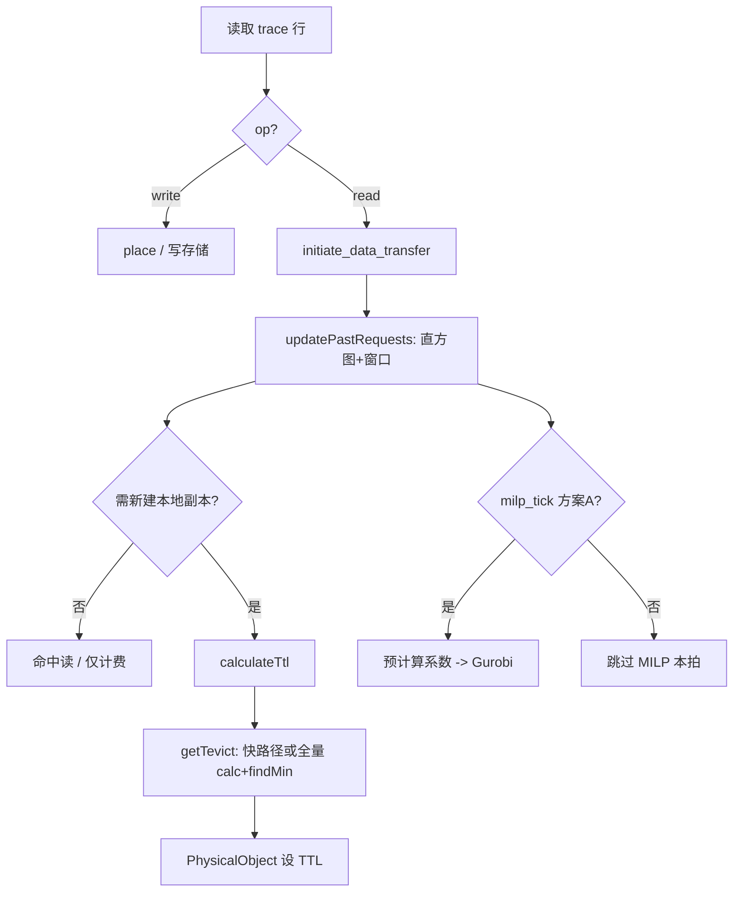

## 9. 文档索引

| 文档 | 内容 |
|------|------|
| `docs/PolicyMilpECnewV2_Design.md` | EC(2+0)、联动驱逐、与 Tevict 关系（历史；**V3 正文以 §10 与 `PolicyTevictRangesNew` 为准**） |
| `docs/SKYSTORE_PAPER_DATASETS.md` | 论文侧五条 trace 特征 |
| `docs/DATASET_ANALYSIS_REPORT.md` | 本仓库 trace 与工具 |
| **§10.0**（本文） | **白话导读**：先读，再读 §10.3 公式与 §10.3.2.5 表 |
| **`docs/PolicyMilpECnewV3_Gurobi_Spec.md`** | **Gurobi 可落地版**：变量/取值、**TTL 作 time 算存储**、约束目标、伪代码、双流程图 |
| **`docs/PolicyMilpECnewV3_CodeDesign.md`** | **代码设计**：包/类、`PolicyMilpECnewV3` 方法清单、`SimulatorV2`/`Config` 对接、实现顺序 |
| **§10.9～§10.12**（本文） | 术语表、矛盾标注、伪代码/流程图、与 `PolicyTevictRangesNew`+`SimulatorV2` 对齐 |

---

## 10. 定稿方案（讨论版）：MILP + EC(2+1) + Replicate + TTL + Histogram + Cost-Optimal

> 本节在 **不删减** 下列关键词的前提下写清主路径：**MILP**、**EC(2+1)**、**Replicate**、**TTL**、**Histogram**、**Cost-Optimal**；驱逐语义与 **`PolicyTevictRangesNew`** 对齐；**Gurobi** 求解 **总成本最小**。

### 10.0 先把话说清楚（读不懂时先看这里）

**这份文档到底在讲什么？**  
用一句话：**仿真里用「直方图」估计访问规律 → 决定副本能存多久（TTL）→  Optionally 用 MILP 再决定是多副本还是纠删码布局；Gurobi 只负责最后一步的「选方案」，而且只吃「已经算好的数字系数」。**

**为什么要写那么多符号？**  
因为 **Gurobi** 这类求解器要求：目标函数必须是 **常数 + 系数×0/1变量** 这种 **线性** 形式。直方图本身是 **很多桶的向量**，**不能**整根塞进求解器，所以要先在 Java 里 **乘价目表、加成「一个数」**，文档里用 \(S^{\mathrm{rep}}_r\) 等符号表示这些 **已经算好的系数**。**看不懂公式时，可以把它当成「每个候选放置位置对应一个人民币成本」**。

**源码里最容易混的三条线（务必分开想）**

| 线 | 在干什么 | 像什么 |
|----|----------|--------|
| **① 直方图** | 每条 **读请求** 可能调用 `updatePastRequests`，往表里 **加 GB、记间隔** | 记账本：**越读越厚** |
| **② TTL 数值** | 新副本要一个「能存多久」的秒数时，仿真器去问策略；**不是**「每个 region 只有一个数、定时改一次」 | 见下 **② 人话** |
| **③ MILP（V3 设计）** | 在约定时刻决定 **副本 vs EC**；**和 ①② 用同一套价目表/统计更省心**，但源码 **不会自动帮你对齐**，要自己绑「触发节拍」 | 定期开会选方案：**不能每个对象开一次会** |

**② 人话：TTL 到底是谁的？多久变一次？**

想象你要给 **新落下来的副本** 贴一张「保质期」标签：

- **不是**「整个 region 共用一个 TTL，到了点就全体换一个新数」。源码里是 **「从哪读过来 → 落到哪」这种组合** 各自记一份 TTL（可以想成：**线路 A→B** 和 **线路 C→B** 标签可以不一样）。  
- **多久重新认真算一遍？** 代码里有个 **偷懒规则**：对 **落地那一侧（dst）** 来说，若仿真时钟上 **距离上次「大算」还不到约 12 小时**，就 **不再重算整张表**，直接 **沿用这条线路上次算出来的 TTL**。所以 **新副本** 在这段时间里拿到的，往往是 **上一次大算时留下的那个数**，**不是**每来一个对象就重新跑一遍全套公式。  
- **新对象什么时候拿数？** 只在 **仿真要创建/给这个副本写 TTL 的那一刻** 去问一次；拿到的是 **当时** 要么沿用、要么刚大算出来的结果。

**你只要记住三句：**（1）**按「从哪读到哪」记 TTL，不是按「一个 region 一个万能 TTL」。**（2）**大约每 12 小时（仿真时间）才可能重新大算一轮**（对同一落地 region 的门控如此）。**（3）**新对象不自带定时器，是「要贴标签时现问」。**  

> 变量名、列表、`find_min` 等细节见 **§10.3.2.5**；这里刻意不写代码字。

**和 `window_size=-1` 的关系**  
配置里常见 **`window_size: -1`**：意思是 **直方图不按整点小时「清空再重来」**，而是一直累计。**所以**若你希望「每小时 MILP 一次、和直方图同一拍」，**不能**指望 `-1` 自动给你整点；要 **自己设一个 \(\Delta T\)** 或在 **`hist` 交换**时解（见 §10.3.2.4～§10.3.2.5）。

**建议阅读顺序**  
1. 本节（10.0） → 2. §10.3.3（**要数清单 + 钱怎么换算成 \(S,T\)**）→ 3. §10.3.2.5 **白话摘要** → 4. 需要时再查 §10.3 公式与 §10.9 术语表。

### 10.1 关键词与分工（必须同时成立）

| 关键词 | 含义 |
|--------|------|
| **Cost-Optimal** | **Gurobi 求解的 MILP** 目标为 **总成本最低**（存储 + 请求 + 传输 + 仿真器已有其它项，系数由价目表与聚合统计给出）。 |
| **MILP** | 决策 **冗余形态**（**Replicate** vs **EC(2+1)**）；若为 EC，则 **三片放置**（三个 **不同 region**）。 |
| **EC(2+1)** | 2 数据片 + 1 校验片，共 3 片；**允许丢失 1 片**仍可读；**不得**长期只保留 1 片（见 §10.5）。 |
| **Replicate** | 完整对象拷贝；与 EC **稳态互斥**（同一时刻布局由 \(z\in\{0,1\}\) 决定）。 |
| **Histogram + TTL** | 驱逐用的 TTL 与 **`PolicyTevictRangesNew` 相同**：**\(T_{\mathrm{even}}/2\)** 初值 + **直方图** `calcEvictCost` / `findMin`；**不**另起一套直方图频率（与 V2 一致）。 |
| **EC 片 TTL** | **每片 TTL = 该片所在 region 上由 TevictRangesNew 算出的 TTL**（与「区域 TTL」一致）。 |

### 10.2 区域互斥（同一逻辑对象）

- **三片 EC**：**任意两片不得在同一 region**（\(\forall r,\ \sum_{k=1}^3 y_{r,k}\le 1\)）。  
- **副本与 EC 片**：**同一 region 不得同时放「完整副本」与「任一片」**（\(\forall r,\ x_r + \sum_k y_{r,k} \le 1\)）。  
- **稳态**：**要么** 纯副本布局 **要么** 纯 EC 三片布局（由 MILP 的 \(z\) 表达）；迁移期若实现双布局，仍须满足上两条 **逐 region 互斥**。

### 10.3 Gurobi MILP 数学规范（单聚合单元、稳态）

**集合**：\(\mathcal{R}=\{1,\ldots,n\}\) 为区域；\(b\in\mathcal{R}\) 为 **Fixed-Base** 基底。

**参数（非负，由 Histogram 聚合预测 + 价目表预计算）**

- \(S^{\mathrm{rep}}_r\)：在 \(r\) 保留 **完整副本** 的 **存储+分摊请求** 线性系数（窗口内）。  
- \(S^{\mathrm{ec}}_{r,k}\)：在 \(r\) 放 **第 \(k\) 片**（\(k\in\{1,2,3\}\)）的同类系数。  
- \(T^{\mathrm{rep}}\)、\(T^{\mathrm{ec}}\)：与布局相关的 **跨区传输 + 读路径** 线性近似（常数或 \(\sum_r \alpha_r(\cdot)\)）；实现上可与 `DiGraph` 边权一致。

**二进制决策变量**

- \(z\in\{0,1\}\)：\(z=0\) → **Replicate**；\(z=1\) → **EC(2+1)**。  
- \(x_r\in\{0,1\}\)：区域 \(r\) 是否放 **完整副本**。  
- \(y_{r,k}\in\{0,1\}\)：片 \(k\) 是否在区域 \(r\)。

**约束**

\[
\begin{aligned}
&\text{(C1 互斥)} && x_r \le 1-z,\quad y_{r,k}\le z && \forall r,k \\
&\text{(C2 副本)} && \sum_{r\in\mathcal{R}} x_r \ge 1-z,\quad x_b \ge 1-z \\
&\text{(C3 EC 三片)} && \sum_{r} y_{r,k} = z\ \ \forall k;\quad
\sum_{k} y_{r,k} \le z\ \ \forall r \\
&\text{(C4 片不共区)} && \sum_{k=1}^3 y_{r,k} \le 1 && \forall r \\
&\text{(C5 副本与片不共区)} && x_r + \sum_{k=1}^3 y_{r,k} \le 1 && \forall r
\end{aligned}
\]

**目标（Gurobi `GRB.MINIMIZE`）——总成本最低**

\[
\min\ \ (1-z)\Big(\sum_{r\in\mathcal{R}} S^{\mathrm{rep}}_r x_r + T^{\mathrm{rep}}\Big)
\ +\ z\Big(\sum_{r,k} S^{\mathrm{ec}}_{r,k} y_{r,k} + T^{\mathrm{ec}}\Big).
\]

**Gurobi 映射**：`model.addVar(vtype=GRB.BINARY)`；线性约束 `addConstr`；`setObjective(linExpr, GRB.MINIMIZE)`。

### 10.3.3 要算哪些数、数与数之间怎么换（人话）

**本节不讲**：直方图每个桶怎么从 trace 抠出来（那是 TevictRanges）。  
**本节只讲**：为了 §10.3 的 MILP，**你必须准备哪些数**、**这些数之间用什么公式互相变成什么**。

---

**省流三句**

1. **先**把「业务量」（字节、次数、预测流量）和「价目表」（存储/请求单价、边 `cost`）**全部乘完、加完**，变成 **同一套成本单位**（就当「元」）里的 **常数** 和 **「若选这个 0/1 就多花多少钱」的系数**。  
2. **再**把这些常数/系数填进 **\(S^{\mathrm{rep}}_r\)、\(S^{\mathrm{ec}}_{r,k}\)、\(T^{\mathrm{rep}}\)、\(T^{\mathrm{ec}}\)**——它们 **没有魔法**，就是 **已经算好的钱**。  
3. **最后** Gurobi 只选 **\(z,x,y\)** 谁为 1，相当于在 **两套已经算好的账单**（副本一套、EC 一套）里 **挑便宜的组合**。

---

#### （1）要数清单：从「原始」到「进求解器」一共几类数？

| 序号 | 这类数叫什么 | 单位/性质 | 用来干什么 |
|------|----------------|-----------|------------|
| **A** | 价目与拓扑 | 单价（元/GB/时间…）、边 `cost`（元/GB 或无量纲与实现一致） | **乘**业务量 → 钱 |
| **B** | 窗口内业务量（聚合后） | 字节、次数、或已压成一维的「预测量」 | 被 **A** 乘，变成 **钱** |
| **C** | 线性系数 \(S^{\mathrm{rep}}_r\)、\(S^{\mathrm{ec}}_{r,k}\) | **钱**（与 \(x_r=1\) 或 \(y_{r,k}=1\) 绑定的边际） | 进目标函数 **`coeff * var`** |
| **D** | 常数项 \(T^{\mathrm{rep}}\)、\(T^{\mathrm{ec}}\) | **钱**（与具体选哪个 \(x_r\) **无关**、但与「走副本方案 / 走 EC 方案」有关） | 加在目标里；再乘 \((1-z)\) 或 \(z\) |
| **E** | 决策变量 \(z,x_r,y_{r,k}\) | 0 或 1 | Gurobi **输出** |
| **F** | 目标值 ObjVal | **钱** | Gurobi **输出**（总成本） |

**直方图**：在表里 **不出现**；它只负责在 **算 B** 时给你 **更好的一组预测数**。**进 MILP 的只有 A×B 之后的东西（C、D）。**

---

#### （2）数与数怎么转换？——三条链（只写关系，不讲桶内细节）

**链 1：业务量 → \(S\)（挂到某个 0/1 上）**

\[
\text{（某区存储量或等价 GB）} \times \text{（该区存储单价）} + \text{（分摊到该区的请求量）} \times \text{（请求单价）}
\;\Rightarrow\;
\text{一个数，记到 } S^{\mathrm{rep}}_r \text{ 或 } S^{\mathrm{ec}}_{r,k}.
\]

**人话**：先算「**若**在 \(r\) 放整副本 / **若**片 \(k\) 在 \(r\)，**多花多少存储+请求钱**」，这个数字 **钉在** \(x_r\) 或 \(y_{r,k}\) 上。

##### （链 1 补充）你心里那公式 `Storage_cost = size × time × price`：size 是谁？time 取多长？

容易混的是：**仿真里真扣钱** 和 **MILP 里填系数 \(S\)** 用的是 **同一套价目表**，但 **size / time 的含义不完全相同**——下面分两种语境说人话。

**A）仿真里「真结账」——以仓库代码为准（已实现）**

- 代码：`RegionManager` 里 **`cost = pricePerGB(region, duration) × sizeInGb`**（摘除或结算剩余存储时同理）。  
- **size**：**`PhysicalObject.getSize()` 换成 GB**。整副本就是 **对象逻辑大小**；若是 EC 分片，则是 **该片字节数**（小于整对象）。  
- **time**：这里的 **`duration`** 是 **仿真时钟里真实占用了多久**——从 **`storageStartTime`** 算到 **摘除/结算时刻**，并且 **可能被 TTL 截断**（见同文件里对 `duration` 的分支）。**不是**你先拍脑袋的一个常数，而是 **事件驱动** 算出来的 **时长**。  
- **price**：`pricePerGB(region, duration)` 把节点上的 **`priceStorage`**（工程里按 **月** 口径再参与换算）和 **`duration` 折成「天」** 乘在一起（见 `RegionManager.pricePerGB`）。所以你心里可以记：**真扣钱 = GB ×（按天折算的存储单价链）**，等价于 **size × time × 单价**，**time 是真实驻留时间**。

**B）MILP 里填 \(S^{\mathrm{rep}}_r\) / \(S^{\mathrm{ec}}_{r,k}\)——是「规划用的边际」，要你自己定一个时间尺度**

- **size（建议）**：  
  - **副本**：用 **聚合单元** 的代表 **逻辑大小（GB）**（单个模板对象或该单元在窗口内 **等效 GB**）。  
  - **EC 片**：同一逻辑大小下 **片大小 ≈ size\(_\mathrm{logic}\)/K**（\(K\) 为数据片数，与 §10.3 EC 定义一致）。  
- **time（建议）**：取 **一个统一的规划长度 \(W\)**，和 §10.3.1（1.1）里的 **`window_fraction`** 一致——例如「**未来 24h**」「**下一个 MILP 窗**」。含义是：**在比较「把副本放 r」vs「把片放 r」谁更省**时，大家用 **同一段未来 \(W\)** 来折现存储费，而不是把仿真里每个对象的 **`duration`** 搬进 MILP。  
- **若你愿意用预测 TTL 当 time**：也可以令 **\(W \approx\)** 该区 **`getTevict` 给出的 TTL（换算成小时/天）**——这是 **设计选择**，必须在 **V3 实现里写死一种**，并在日志里能复现。

**对照一句**：**仿真** = 真实 **`duration` × GB × 单价**；**MILP 的 \(S\)** = **GB（或片 GB）× 你选的规划窗 \(W\)（或 TTL）× 单价** 得到的 **边际系数**，用来 **比较布局**，不是逐对象 replay 仿真账单。

**链 2：业务量 + 边权 → \(T\)（先加成常数）**

\[
\sum_{\text{边}} (\text{预计走这条边的流量}) \times (\text{该边 cost}) \;+\; \sum (\text{读次数}) \times (\text{GET 单价})
\;\Rightarrow\;
T^{\mathrm{rep}} \text{ 或 } T^{\mathrm{ec}} \text{（各算一遍，假设不同）}.
\]

**人话**：**传输+读** 往往 **不拆成「每个 \(x_r\) 一项」**，而是先 **加成一个总数** \(T\)；**副本布局** 估一次得 \(T^{\mathrm{rep}}\)，**EC 布局** 再估一次得 \(T^{\mathrm{ec}}\)。

**链 3：\(z\) 只做开关，不做换算**

- **\(z=0\)**：目标里 **只加** \((1-z)\bigl(\sum_r S^{\mathrm{rep}}_r x_r + T^{\mathrm{rep}}\bigr)\) 这条（数学上 \((1-z)=1\)）。  
- **\(z=1\)**：目标里 **只加** \(z\bigl(\sum_{r,k} S^{\mathrm{ec}}_{r,k} y_{r,k} + T^{\mathrm{ec}}\bigr)\) 这条（数学上 \(z=1\)）。  

**人话**：**不是**把 \(S\) 变成 \(T\)，而是 **两套账单事先都算好**，用 \(z\) **二选一**用哪套。

---

#### （3）和 §10.3 符号一一对应（方便你对照公式）

| 符号 | 是常数还是跟着 0/1 变 | 白话 |
|------|------------------------|------|
| \(S^{\mathrm{rep}}_r\) | 乘在 \(x_r\) 上 | 「选 reg \(r\) 放整副本」多花的 **存储+分摊请求** 钱，**一个 \(r\) 一个数** |
| \(S^{\mathrm{ec}}_{r,k}\) | 乘在 \(y_{r,k}\) 上 | 「片 \(k\) 落在 reg \(r\)」多花的那一份钱 |
| \(T^{\mathrm{rep}},T^{\mathrm{ec}}\) | 常数项（再乘 \((1-z)\) 或 \(z\)） | **没绑在具体哪个 \(x_r\)** 上的那截 **传输+读** 钱 |

---

#### （4）只验算「线性」长什么样（数字全是钱）

3 个 region，只做副本，\(z=0\)。已换算好 **\(S^{\mathrm{rep}}_1=100,\ S^{\mathrm{rep}}_2=80,\ S^{\mathrm{rep}}_3=120\)**，另有 **\(T^{\mathrm{rep}}=50\)**（与选谁无关）。约束 **恰一区放副本**：\(x_1+x_2+x_3=1\)。  
目标：**最小化** \(50 + 100x_1+80x_2+120x_3\)。最优 **\(x_2=1\)**，总成本 **130**。这里 **没有第二种单位**，全是 **加法**。

### 10.3.1 Gurobi 实现的 MILP：**输入**与**输出**

本节说明：在代码侧调用 Gurobi 构建并求解 §10.3 模型时，**送进求解器的数据（输入）**与**求解结束后取回的结果（输出）**分别是什么，便于与仿真器、价目表、直方图模块对接。

#### （1）输入（构建 `GRBModel` 所需）

| 类别 | 内容 | 说明 |
|------|------|------|
| **拓扑与索引** | 区域列表 \(\mathcal{R}\)、基底 \(b\)、片索引 \(k\in\{1,2,3\}\) | 来自 `Config.regions` / `DiGraph` 节点；决定变量个数为 \(1 + |\mathcal{R}| + 3|\mathcal{R}|\)（\(z,x_r,y_{r,k}\)）。 |
| **成本系数（参数）** | \(S^{\mathrm{rep}}_r\)、\(S^{\mathrm{ec}}_{r,k}\)、\(T^{\mathrm{rep}}\)、\(T^{\mathrm{ec}}\) | **MILP 的数值输入核心**：由 **价目表**（存储/请求/传输单价）与 **Histogram 聚合后的预测量**（各区读写字节率、请求率等）在 **调用 Gurobi 之前** 预计算为 **标量或线性项系数**，再填入 `LinExpr`。 |
| **约束右端与结构** | C1～C5 的线性不等式/等式 | 多数为 **固定 0/1 组合**（如 \(x_r\le 1-z\)），在代码里用 `addConstr` 绑定变量；**不**随请求变化，除非动态改 \(b\) 或区域集合。 |
| **求解器参数（可选）** | 时间上限、MipGap、线程数、Log | `model.setParam(GRB.Param.TimeLimit, ...)` 等；属 **Gurobi 运行参数**，不改变数学模型，但影响是否拿到可行解。 |

**小结**：**输入** = **结构（谁与谁连约束）** + **数值系数（\(S^{\cdot},T^{\cdot}\)）** + **可选 Gurobi 参数**。**直方图本身不直接作为 Gurobi 变量**；它只参与 **在进 Gurobi 之前** 把统计量打成 **\(S^{\mathrm{rep}}_\cdot\)、\(S^{\mathrm{ec}}_{\cdot,\cdot}\)、\(T^{\mathrm{rep}}\)、\(T^{\mathrm{ec}}\)**。

##### （1.1）补充：如何把「价目表 + Histogram 测量量」预计算成 **标量** / **线性项系数**

Gurobi 里 **目标函数必须是决策变量的线性函数**（二进制 \(z,x_r,y_{r,k}\) 与常数）。因此仿真里测到的 **字节数、次数、时间窗** 要先在 **Java 里乘完单价、加总成「一个数」或「乘以某个 \(x_r\) 的系数」**，再 `LinExpr.addTerm(coeff, var)`。

| 类型 | 含义 | 典型算式（示意） |
|------|------|------------------|
| **标量（常数项）** | 与 **是否放置** 无关、在窗口内固定的成本 | 例如：已发生的 **固定请求费**、与布局无关的 **基底元数据费**；或把「某段预测流量」在 **固定路由假设** 下算成 **一个数** \(c_0\)，`obj += c_0`。 |
| **线性系数（乘 \(x_r\) 或 \(y_{r,k}\)）** | **多选 1 个在 \(r\) 放副本** 时，**额外** 承担多少成本 | **存储**：\(S^{\mathrm{rep}}_r \approx \texttt{size\_GB} \times \texttt{price\_store}[r] \times \texttt{window\_fraction}\)（对象或聚合单元的逻辑大小 × 单价 × 时间比例）。**请求**：\(\texttt{pred\_GETs\_in\_r} \times \texttt{price\_GET}\) 按区汇总后摊到「若在该区放副本」的边际。 |
| **\(T^{\mathrm{rep}},T^{\mathrm{ec}}\)** | 传输 + 读路径 | 由 **Histogram 给出的预测读区分布**（如各区 GET 权重）× **对象/聚合字节** × **边 \((src,dst)\) 的 `cost`**，在 **假设**「副本布局」与「EC 布局」下各算一条 **总传输费**，再作为常数或 **对 \(z\) 分段**：\((1-z)\cdot T^{\mathrm{rep}}\) 与 \(z\cdot T^{\mathrm{ec}}\)。若 EC 读需 **2 片跨区**，把 **两条边费用上界** 或 **期望** 先算成标量。 |

**一句话**：**测量量**（直方图桶里的字节、次数、区间）→ **乘价目表** → **按「若 \(x_r=1\)」或「若 \(y_{r,k}=1\)」的边际** 填成 **系数**；**与布局无关的部分** 合并为 **标量**。**不许**把「原始 Histogram 向量」直接进 Gurobi，除非改成 **分段线性 / 外逼近**（本设计采用 **预聚合系数**）。

### 10.3.2 MILP 触发方案（避免「每对象一解」超时）

**问题**：若 **每个对象、每次冗余** 都调用一次 Gurobi，请求量一大即 **求解次数爆炸**，易出现 **超时、跑不出结果**——与 §10.7（1）「出现冗余后再判」的 **语义** 不矛盾，但与 **工程实现** 必须分开：**语义上**「何时**可以**做 rep/EC 决策」≠「何时**真的**调用求解器」。

**推荐触发（与 Histogram 对齐，可组合）**：

| 方案 | 做法 | 优点 |
|------|------|------|
| **A. 与直方图同频** | **Histogram 刷新** 时（同一 `lastUpdated` / 时间轮），对 **聚合单元**（例如 **region 级**、**大小桶级**）**最多解 1 次 MILP**，更新本单元 **全局策略**（或该批对象的默认布局模板）。 | 与 TTL 统计 **同一时钟**，系数 **同步**；求解次数 **有上界**。 |
| **B. 事件 + 防抖** | 跨区读、冗余产生时只 **置位 `pending_milp`**；**防抖**：距上次求解 **≥ \(\Delta t\)** 或 **累计事件 ≥ N** 才真正 `optimize()`。 | 避免 **每条请求** 都进求解器。 |
| **C. 聚合单元单例** | **同一聚合单元**（如某 `(bucket, 大小桶)` 或 **单 region 统计桶**）在窗口内 **合并为一次 MILP**（变量仍是 §10.3 的那套，**不是** per-object 复制变量）。 | 与 §10.3 **单聚合单元** 数学一致；**禁止**为百万对象建百万个 \(z\)。 |
| **D. 独立统计窗口** | 与 Tevict **直方图时间窗**解耦：在仿真器或策略内维护 **另一套**「写/读字节累计、事件计数」，当 **窗满 / 事件超阈 / 区域集合过大** 时触发 MILP（参数与实现待定）。 | **不**绑定 `hist` 交换节拍；需自行保证 **不会**每请求一解。 |

**结论（逻辑层）**：**冗余出现** 只作为 **准入条件**；**真正调用 Gurobi** 放在 **直方图刷新时刻** 或 **防抖后的窗口结束**，且 **按聚合单元** 求解 **一次**。

**科研仿真约定（本仓库）**：价目表由 **`profiles/*.csv` 等** 固定给出，**仿真过程中不修改**；**不设**「价目表变更触发 MILP」。MILP 系数变化仅来自 **Histogram 统计随请求演化**。

##### 10.3.2.1 各方案「详细说明 + 小例子**

- **A. 与直方图同频**  
  - **含义**：每次 TevictRanges 系策略执行 **`last_updated` 推进**或 **next_hist ↔ hist 交换**（与 `update_past_requests` 窗口逻辑一致）时，顺带设 **`milp_tick = true`**，对本 **region 聚合桶** 只做 **1 次** `optimize()`。  
  - **例**：某 region 直方图 **每小时** 滚动一次，则 MILP **最多每小时 1 次**，与 TTL 输入 **同一批系数**。

- **B. 事件 + 防抖**  
  - **含义**：跨区读置位 `pending_milp=true`，但 **冷却** 未满则不解；冷却条件例如 **`now - last_milp_time ≥ 5min`** 或 **`pending_count ≥ 50`**。  
  - **例**：T29 百万级 GET，若每 miss 都 MILP 会爆；防抖后 **最多每 5 分钟** 解一次（数值可调）。

- **C. 聚合单元单例**  
  - **含义**：变量只有 **一套** \(z,x_r,y_{r,k}\)，对应 **「该 bucket / 该 region 统计桶」** 的 **代表对象** 或 **模板**，不是 trace 里每个 `obj_key` 各建一套。  
  - **例**：「`size_bucket=small` × `hot_region=regB`」**共享** 一次 MILP 结果，新对象 **继承** 模板直到下次刷新。

- **D. 独立统计窗口**  
  - **含义**：不依赖 §10.3.2.4 的 `hist` 滚动，用 **单独计数器**（时间窗、事件数、活跃 region 数等）触发 MILP。  
  - **例**：**24h** 仿真窗满 **或** 累计跨区读字节 **≥ 阈值** → 触发（阈值与 `PolicyTevictRangesNew` 的 `window_size` **无必然相等**）。

##### 10.3.2.2 实现复杂度 vs 预期效果（排序）

| 排序 | 策略 | 实现复杂度 | 预期效果 |
|------|------|------------|----------|
| **1（最简，优先落地）** | **仅 D** | 低：在策略内自建窗口统计 | 与 Tevict 直方图 **解耦**，易先跑通 MILP 管线；须 **显式**防每请求一解 |
| **2** | **D + C** | 中：需定义「聚合单元」键（如 region） | 进一步 **压低** 模型规模，适合 **region 级** V3 |
| **3** | **D + B** | 中：加时间戳与 pending 队列 | 对 **突发 trace** 更稳，避免窗内空转 |
| **4（最全）** | **A + B + C**（或 **A+D**） | 高：与直方图时钟 **严格绑定** | **系数与 TTL 最同步**；实现与调试成本最高 |

**优先建议**：先实现 **§10.3 单聚合单元 MILP**；触发优先 **A（与 §10.3.2.5 TTL/直方图节拍对齐）** 或 **D**；跑通后再叠 **C（模板继承）**；**B** 见 §10.3.2.3、§10.3.2.5。

##### 10.3.2.3 方案 A、B、C 的关系（结论）

- **A（与直方图同频）** 只规定 **「何时调用 `optimize()`」**：绑在 TevictRanges 系策略里 **`last_updated` 推进**或 **`next_hist` → `hist` 交换**等事件上，使 MILP 系数与 **同一批直方图统计**对齐。
- **B（事件 + 防抖）** 规定 **「若还存在按请求/事件触发的求解路径」**时如何 **限频**（冷却时间 \(\Delta t\)、累计事件 \(N\) 等）。若实现上 **仅在 A 的时刻**解 MILP，且 **没有**其它触发源，则 **B 常显多余**；一旦引入 **pending / 跨区读即标位**等 **非直方图**触发，**B 仍有独立价值**。
- **C（聚合单元单例）** 规定 **「单次 MILP 的变量规模」**：每个聚合单元 **一套** \(z,x_r,y_{r,k}\)，**不是** trace 里每个 `obj_key` 一套。**A 不蕴含 C**：可以「每小时解一次」但仍按 **每对象**建变量（不可取）；**C 须单独作为模型/实现约束**。
- **小结**：**A = 时钟与触发**；**C = 问题规模与模板**；**B = 在存在额外事件触发时的保险**。以 **A 为主**合理；**「A+B+C」**应理解为 **三层正交设计**的叠加，**不是**「只实现 A 就自动等于 B、C」。

##### 10.3.2.4 `PolicyTevictRangesNew` 直方图刷新：触发点与频率（依据源码）

以下对应 Python 侧 **`policy_tevict_ranges_new.py`** 中 **`update_past_requests`**（Java 镜像逻辑应对齐）。参数 **`window_size`** 来自 **`config.window_size`**，单位为 **小时**。

| 条件 | 行为（摘要） |
|------|----------------|
| **`window_size == -1`** | **不执行**下文「时间窗推进 / 交换」分支；`last_updated` 在初始化中取 **纪元时刻**；等价于 **不按固定小时窗滚动** `hist`/`next_hist`（整段历史模式，与「每 1h 滚一次」不同）；直方图统计 **持续累计、不清空**（与 TTL/MILP 同频如何约定见 **§10.3.2.5**）。 |
| **`window_size != -1`** 且 **`last_updated is None`** 或 **`is_large_time_gap`**：`abs(当前请求时间 - last_updated) > window_size × 2`（小时） | **整表重置**：`hist`、`last_hist`、`past_requests`、`next_*` 等清空；**`last_updated`** 置为当前请求时间 **对齐到整点**（`replace(minute=0, …)`）。 |
| **`window_size != -1`** 且 **`is_next_window`**：**`request.timestamp - last_updated > timedelta(hours=window_size)`** | **推进一格**：`last_updated += timedelta(hours=window_size)`；**`hist ← next_hist`**、**`last_hist ← next_last_hist`**，**`past_requests ← next_past_requests`**；随后清空 **`next_*`**。 |

**触发点**：每次处理 **会调用 `update_past_requests` 的请求**时（Python `simulator_v2` 中 Tevict 系策略在 **`op == "read"`** 路径上调用）检查上述分支。

**频率（在 `window_size > 0` 时）**：理想情况下 **大约每 `window_size` 小时至多发生一次**「交换」；实现上 **单次调用只做一轮** `elif is_next_window`（无 `while` 追赶），若仿真时间 **跳空多个窗**，可能需 **多条后续请求** 多次进入 `update_past_requests` 才能逐步「追上」。**`is_next_window`** 使用 **严格大于** `window_size` 小时（`>`），边界与整点舍入需与 trace 对齐理解。

> **配置提示**：本仓库若干示例 yaml 中 **`window_size: -1`** 常见；若要 **「与 1h 直方图同频」的 A**，需在配置中显式设 **`window_size: 1`**（或目标小时数），并确认仿真路径会触发 `update_past_requests`。

##### 10.3.2.5 TTL 的计算时机、刷新频率与 MILP 节拍（依据 `PolicyTevictRangesNew` / `policy_tevict_ranges_new.py`）

**白话摘要（读表前先读这段）**

1. **「直方图多久刷新？」** —— **每条读请求** 都可能往里 **加数据**；若 `window_size>0`，大约每隔 **`window_size` 小时** 把「草稿」**提交**成正式一版（`hist` 那一套）；若 `window_size=-1`，**没有「提交成固定一版」这件事**，数据 **一直累加**。  
2. **「TTL 多久变一次？」** —— **给新副本设 TTL** 是在 **`getTevict` 被调用**时（常见是 **新副本创建**）。此外 **12 小时内** 对同一 `(src,dst)` 可能 **直接返回上次算过的 TTL**（缓存），所以 **TTL 变慢的节拍** 和 **直方图变厚的节拍** **不一定相同**。  
3. **「和 MILP 啥关系？」** —— MILP 若要用「和直方图同一批统计」，需要你在实现里 **自己规定**：在 **`hist` 交换**时解、还是每 \(\Delta T\) 解；源码 **没有**写死「MILP 与 TTL 同一定时器」。

以下 **仅**依据 **`PolicyTevictRangesNew.java`** 与 **`simulation/.../policy_tevict_ranges_new.py`**（及 **`SimulatorV2`** 调用关系），**不**引用其它 MILP 策略类。

**（1）直方图何时更新、多久「换一批系数」**

| 源码入口 | 时机 | 频率/语义 |
|----------|------|-----------|
| **`updatePastRequests(request, placeRegion)`** | 仿真器在 **`initiate_data_transfer(..., op="read")`** 中，对 `tevict_ranges` 等策略 **每条读请求**调用一次（Java：`SimulatorV2` 约 261–272 行；与 Python `simulator_v2` 读路径一致）。 | **每处理一条 READ** 即可能累积 **`next_hist` / `next_last_hist` / `next_past_requests` / `next_num_requests`**。 |
| **`window_size > 0`** | 同一次 `updatePastRequests` 内若满足 §10.3.2.4 的 **`is_next_window` / 大间隔重置`**，则 **`hist ← next_hist`** 等，**`num_requests` 同步自 `next_*`**。 | **直方图「提交到 calcEvictCost」用的快照**约每 **`window_size` 小时**换一批（外加大间隔整表清空）。 |
| **`window_size == -1`** | **不**做 `hist`/`next_hist` 交换；`calcEvictCost` **始终读** `next_hist`/`next_last_hist`（Java 231–236 行；Python `calc_evict_cost` 240–244 行）。 | 统计 **全程累计**；**不存在**「按小时清空」的直方图时钟。 |

**（2）`calcEvictCost` / `findMin` 何时跑——这不等于「每条请求算 TTL」**

| 步骤 | 源码 | 说明 |
|------|------|------|
| **候选 TTL 网格** | `calcEvictCost(region, teven_hours, net_cost)` | 在 **`ranges[]`**（约 2% 指数桶）上枚举候选驱逐时间 \(T\)，用 **`hist`+`last_hist`** 估 **存储费 vs 再传一次网费** 的权衡，返回 **成本最小** 的 **`ranges[ret]`**（小时量级，见 Java 227–288 行）。 |
| **是否采用直方图结果** | **`findMin(y, teven, region, timestamp)`** | 若 **`y == -1`**（无直方图）或 **`lastUpdated == null`**（仅 `window_size>0` 时可能）或 **该区累计请求数 `< 1000`**（`next_num_requests` 或 `num_requests`，视 `window_size` 分支），则 TTL 取 **`teven/2`（小时）× 3600 → 秒**；否则取 **`y`**（即 `calcEvictCost` 返回值，小时）× 3600。**阈值 1000** 见 Java 365–368 行 / Python `find_min` 356–363 行。 |
| **谁在调 `getTevict`** | **`getTevict(src, dst, timestamp)`** | 先查 **dst 的 12 小时快路径**（Java 300–305：若当前 `timestamp` 仍早于 **`seenDays[dst]` 最后一次记录 + 12h**，则直接返回 **`regionPairsTtl(src,dst)` 上一次**；Python `get_tevict` 321–325 行同构）。否则 **嵌套双重循环** 对所有 **`(region, region2)`** 算一遍，**每次**向 `region_pairs_ttl` **append** 新值，最后取 **`(src,dst)` 列表末尾**。 |

**（3）仿真器把 TTL 写进对象的时机（「物理 TTL 刷新」）**

| 时机 | 源码 | 含义 |
|------|------|------|
| **新副本/新片落地** | **`SimulatorV2.initiate_data_transfer`** 内 **`calculateTtl`** → 对 `tevict_ranges` 路径调用 **`placementPolicy.getTevict(...)`**（Java 640–713 行） | TTL 数值在 **创建 `PhysicalObject` 时**写入；**不是**后台定时器每秒改 TTL。 |
| **多副本择优** | 若已有其它区副本，`getTevict(read_r, issueRegion, ts)` **多路比较**后取 **`ttlValue`**（698–712 行） | **同一次读**可能选 **最短剩余寿命更紧迫** 的供体副本对应的 TTL 逻辑。 |
| **读路径上的 TTL 刷新** | 同文件 **`refresh_ttl`** 条件（约 325–329 行）：仅当 **跨区读且命中非 base 等** 才可能 **更新已存在对象 TTL** | **并非**每次 GET 都刷新本地副本 TTL；与 **`updatePastRequests` 每读必调** 是 **两条独立逻辑**。 |

**（4）与 MILP 方案 A 的衔接（设计意图）**

- **直方图系数「变」**：`window_size>0` 时在 **`hist←next_hist`** 时刻变一批；`window_size=-1` 时 **连续变**（每次 `calcEvictCost` 都见最新累计）。  
- **TTL 供 `getTevict` 使用**：受 **12h 快路径** + **1000 请求门限** + **`teven/2` 回退** 影响，**不**等于「直方图一换，TTL 必变」。  
- **建议**：若采用 **方案 A**，把 **`milp_tick`** 绑在 **与业务一致的节拍**上（例如与 **`hist` 交换**同 if，或 `window_size=-1` 时与 **显式 \(\Delta T\)** 取样同节拍），使 **MILP 系数**与 **用于构造 `S` 的直方图快照**一致；并知悉 **TTL 仍可能**因 **12h 缓存** 与 **1000 门限** 与「最新直方图」略不同步——属 **源码既有行为**。

<span style="color:red"><b>【笔记 · 问题与规模】</b>：<b>`window_size = -1`</b> 时直方图 <b>持续累计</b>，须 <b>自洽约定</b> **MILP 与 TTL 取样**的 \(\Delta T\)（见上（4））。<b>方案 B</b> 在「仅 A、无额外事件触发」下 <b>【待定】</b>。<b>方案 C</b> 的聚合单元 = **与 MILP 输入统计键一致**（常为 <b>region</b> 或 region×桶）。<b>问题规模</b> = 聚合单元数 × §10.3 单次变量数，<b>非</b>对象条数。</span>

#### （2）输出（`model.optimize()` 之后读取）

| 类别 | 内容 | 说明 |
|------|------|------|
| **解状态** | `model.get(GRB.Attr.Status)` | 如 `OPTIMAL`、`SUBOPTIMAL`、`INFEASIBLE`、`TIME_LIMIT`；**必须先判断**再读变量。 |
| **最优目标值** | `model.get(GRB.Attr.ObjVal)`（或 `ObjBound`） | 对应 §10.3 中 **最小总成本** 的数值；可写入仿真日志或与基线对比。 |
| **最优决策（变量）** | \(z^*\)、\(x_r^*\)、\(y_{r,k}^*\) | `z.get(GRB.DoubleAttr.X)` 等（0/1 或容差内）；**语义输出**为：**选 Replicate 还是 EC(2+1)**；若 EC，**三片分别落在哪些 region**。 |
| **部署映射（下游使用）** | `LayoutDecision` 抽象 | 将 \((z^*,x^*,y^*)\) 编译为 **「副本在哪些区」「片 k 在区 r」**，供 **放置/传输/计费** 模块执行；**TTL 仍由 TevictRangesNew 算**，不来自 Gurobi。 |

**小结**：**输出** = **可行性 + 最优成本** + **离散布局 \((z,x,y)\)**；**不包含** TTL 数值——TTL 由 **PolicyTevictRangesNew + 直方图** 在 **MILP 之后** 按 region 计算。

#### （3）与仿真器的一条数据流（便于实现时对齐）

```text
Histogram / 价目表 / 预测流量
  --> 预计算 S^rep, S^ec, T^rep, T^ec   // MILP 输入（数值）
  --> build GRBModel + addConstr
  --> optimize()
  --> 读 z,x,y 与 ObjVal                 // MILP 输出
  --> 物理放置 + 后续 TTL 驱逐（TevictRangesNew）
```

### 10.4 驱逐：与 PolicyTevictRangesNew 一致（Histogram + \(T_{\mathrm{even}}/2\)）

- **副本**：TTL 计算路径与 **`PolicyTevictRangesNew`** 相同（**直方图桶** + **`calcEvictCost`** + **`findMin`**；冷启动 **\(T_{\mathrm{even}}/2\)** 等，同 V2 源码）。  
- **EC 每片**：**该片所在 region \(r\)** 使用 **同一套** `getTevict(src, r)` / 区域 TTL，即 **片 TTL = 该区域 TevictRanges 算出的 TTL**。

### 10.5 EC 联动删除（仅剩两片且一片因 TTL 到期）

**语义**：EC(2+1) 在 **健康态** 可容忍 **缺 1 片**。若因故障或驱逐已只剩 **2 片**，此时 **再有一片达到 TTL 需被驱逐** 时：**两片一并删除**（**联动删除**），**禁止**留下 **单独 1 片**（单片无法构成可重构集合，无意义且易误判成本）。

```text
onEvictCheck(shard s belonging to object o):
  if layout(o) == EC and aliveShardCount(o) == 2:
      if s 因 TTL 到期应被驱逐:
          delete 全部剩余 EC 片（共 2 片）
          return
  // 健康态 3 片时仍按各片 TTL；任一片到期若可重构则只删该片（或按产品：三片联动，二选一需与计费一致）
```

> **实现注意**：「3 片 → 剩 2 片」与「2 片 → 全删」要写入 **仿真器结算**，避免只删一片导致状态非法。

### 10.6 端到端流程（简述）

1. **统计刷新**：按 TevictRangesNew 的 **histogram 更新频率** 更新各 region 直方图（与 V2 共用钩子）；**触发点与 `window_size` 含义**见 **§10.3.2.4**。  
2. **构造系数** \(S^{\mathrm{rep}}_\cdot\)、\(S^{\mathrm{ec}}_{\cdot,\cdot}\)、\(T^{\mathrm{rep}}\)、\(T^{\mathrm{ec}}\)（由预测读写在各区的分布与价目表生成）。  
3. **调用 Gurobi** 解 §10.3，得 \((z,x,y)\)。  
4. **执行布局**：写副本或写三片；**每片/副本 TTL** 来自 §10.4。  
5. **驱逐扫描**：按 TTL 触发；触发 §10.5 规则。

### 10.7 一句话版策略 + 业务拆解（objectA）+ 三类行为落地

#### （1）一句话版策略

**默认按 FB 先保证可用（基底区本地副本不驱逐），当跨区读导致出现冗余后，再用 MILP 判断「继续保留多副本」还是「转为 2+1 EC」谁更省总成本。**

- **FB**：写入落在 **base**，基底上的 **主副本** 作为可用性底线（与现有仿真「base 不随便删」一致）。  
- **MILP 介入时机（语义）**：**不是**每次 PUT 都解；而是 **已经出现跨区读带来的第二份（或多份）冗余** 之后，**才允许**在 **「副本路径 vs EC(2+1) 路径」** 上做 **成本最优** 选择。  
- **MILP 调用时机（工程）**：**见 §10.3.2**——**禁止**「每对象每事件」都解，否则易超时；应与 **Histogram 同频 / 防抖 / 聚合单元单例** 结合。

#### （2）业务场景拆解（示例对象 **objectA**）

> **与当前 `simulator_v2` 一致**：主循环 **仅处理 `PUT` / `GET`**（映射为 `write` / `read`），**不包含** DELETE 等操作；下表 **不列** DELETE。

| 场景 | 事件 | 含义 |
|------|------|------|
| **场景 1：PUT（首次写入）** | **objectA 在 regA 写入** | 建立 **base=regA** 上的主驻留；通常 **尚无** 跨区冗余，**不**为 rep/EC 二选一。 |
| **场景 2：GET，本地无副本（miss）** | **regB 读 objectA，regB 无对象** | **跨区拉取** + **replicate-on-read**：在 regB 形成 **第二份完整副本** → **冗余出现**（典型 MILP **准入** 路径）。 |
| **场景 3：GET，本地命中（hit）** | **regB 已有 objectA** | **直接读**，计请求费；**可能**不增加新副本；直方图更新；**不一定**触发新的「冗余」状态。 |
| **场景 4：PUT（覆盖/新版本）** | **objectA 在 regA 再次 PUT** | 与 **Python `simulator_v2.versionate_trace`** 及 **`PolicyTevictRangesNew`** 一致：若 `version_enable`，预处理时 **每行 PUT** 对原始 `obj_key` 计数 +1，**每一行**（含 GET）重写为 **`原键-vN`**。`TevictRangesNew` 的 **`update_past_requests`** 以 **`request.obj_key`（含版本）** 为键——**每个版本独立直方图**，与 **PolicyTevictRangesNew** 一致。**MILP 重解** 仍只按 **§10.3.2**，一般 **不**每写必解。 |
| **场景 5：已是 EC(2+1)** | 布局已为三片 | **读** 走「取两片」路径；**驱逐** 按 §10.4/§10.5；**重解 MILP** 仅按 **§10.3.2**（科研仿真中 **价目表 CSV 固定**，不因「价目变化」触发）。 |
| **场景 6：冗余已存在后的 MILP（核心）** | **场景 2** 等使 **≥2 份** 完整副本（或策略定义的冗余态） | **语义上** 进入 **rep vs EC**；**工程上** 调用 **§10.3 MILP** 的时刻由 **§10.3.2** 决定，**不是**每条请求立刻解。 |

**顺序关系**：**1→2→6** 为最常见叙事；**3→5** 为常见稳态；**场景 4** 为分支。凡 **准入**「可判 rep/EC」，**真正 `optimize()`** 仍须遵守 **§10.3.2**。

##### Python artifact：版本化与 TevictRangesNew（依据源码）

- **`simulator_v2.versionate_trace`**（`skystore_python/.../simulator_v2.py`）：读取 trace CSV，**若** `op` 为 PUT **则** `versions[obj_key] += 1`；**随后**对**当前行**（PUT 与 GET 均执行）写入 **`obj_key = 原键 + "-v" + str(versions[原键])`**。故 **同一逻辑键多次 PUT** 得到 **`-v1`, `-v2`, …**；GET 行使用 **扫描到该行为止** 的计数。  
- **`policy_tevict_ranges_new.py`**：`update_past_requests` 等以 **`request.obj_key`** 为字典键维护直方图——**每个 `obj_key`（即每个版本）单独一条统计链**，与 TevictRanges 驱逐语义一致。

**人话版（易混点）**：

- **原始 CSV 里**：多行可以共用 **同一字符串** `obj_key`（同一逻辑对象反复出现）。
- **`versionate_trace` 写出新文件后**：**每一行**的 `obj_key` 都被改写成 **`原键 + "-v" + 版本号`**，**不同版本 = 不同字符串**（如 `foo-v1`、`foo-v2`）。**不存在**「版本化完成后仍多条记录共用一个无后缀 `obj_key`」的情况——**版本信息就在后缀里**。
- **PUT**：先对 **原始键** `versions[原键] += 1`，再写当前行 → **新版本号**体现在本行后缀上。  
- **GET**：**不**递增计数；本行后缀用的是 **处理完本行之前所有 PUT 之后**的 `versions[原键]`（即按 trace **扫描顺序**确定的「当前版本」）。
- **若不做版本化**（未跑 `versionate_trace` / 未开 `version_enable`）：仿真里仍是 **同一 `obj_key` 多行合并**进同一条统计链，与「每版本一条链」的 artifact **不是同一条跑法**。

<span style="color:red"><b>【待定 · 非当前 simulator 能力】</b>：试验中 <b>T29</b> 等 trace 曾出现 <b>transfer_cost</b> 偏大。后续若需「多放几份副本 / 多片」降传输，可考虑：<b>由 MILP 在 Replicate 与 EC shard 之间决定多副本 / 多片的最优布局</b>（相对 §10.3 单套 \(z\) 的扩展）。<b>是否实现、模型是否值得做均待定</b>，仅作思想备忘。</span>

#### （3）三个「真实行为」怎么落地

**A）发生 PUT 怎么办**

- **写本地（FB）**：objectA 落在 **regA（base）**，计 PUT 请求费 + base 存储。  
- **一般不解 MILP**（除非策略规定「每次写后刷新」——与 §10 一句话策略不符时可另配开关）。  
- **直方图**：设计意图含「写侧流量」时，须在策略或仿真器中 **显式**挂钩；**当前** `SimulatorV2` 对 `tevict_ranges` **仅 read** 调用 `updatePastRequests`（见 §10.10（5））。

**B）发生 GET 怎么办**

- **若本 region 已有副本/可服务**：直接读，更新直方图，**可能不产生新冗余**。  
- **若本 region 无对象（如 regB 读 objectA）**：从 **已有副本区** 拉取（ cheapest path ），并 **按需** 在 regB **落地第二份副本**（replicate-on-read）→ **冗余产生**，为 **场景 6（MILP 准入）** 铺路。  
- **此时仍不一定立刻解 MILP**：可实现为 **「冗余出现后的下一事件 / 下一窗口」** 再进 MILP（与 `windowSize=-1`、事件阈值一致）。

**C）冗余已存在时：选 rep 还是 EC（MILP 入口，需与 §10.3.2 对齐）**

- **准入条件（逻辑层）**：对 **objectA** 或 **其所属聚合单元** 判定 **已存在跨区冗余**（例如 ≥2 个完整副本，或策略定义的「可转 EC 的前置状态」）。**仅满足准入** **不等于** 立刻调用 Gurobi。  
- **真触发（工程层）**：在 **§10.3.2** 选定的时刻（如 **Histogram 刷新**、**防抖计时结束**、**`windowFull`/`enoughEvents`** 等），**对该聚合单元** 构造 §10.3 的 **\(S^{\mathrm{rep}}, S^{\mathrm{ec}}, T^{\mathrm{rep}}, T^{\mathrm{ec}}\)**（见 §10.3.1（1.1））→ **单次** `optimize()` → 读 **\(z^*, x^*, y^*\)**。  
- **商榷点**：若 **逐对象** 在 **每次冗余出现后** 立即 MILP，易 **超时**；**推荐** 为该对象 **继承** **所属聚合单元** 最近一次求解得到的 **\(z^*, x^*, y^*\)**（或模板），直到 **下一次** 聚合单元刷新再重解。  
- **落地**：  
  - **\(z^*=0\)**：**继续（或调整）多副本布局**，非 base 副本仍按 **TevictRangesNew TTL** 可驱逐；base 按 FB 保留。  
  - **\(z^*=1\)**：**迁移为 EC(2+1)**（三片落点由 \(y^*_{r,k}\) 给出），并按 §10.4 / §10.5 管 **片 TTL** 与 **仅剩两片时的联动删除**。

### 10.7.1 云实验顶层约束（落实“检查清单”）

本节给出总设计层面的强约束；实现细节见 `PolicyMilpECnewV3_CodeDesign.md` §12.1，流程人话见 `PolicyMilpECnewV3_FullFlow_Human.md` §8。

1. **REQ/T 必含 API 项（首版）**  
   \(\mathrm{REQ}^{rep}\)、\(\mathrm{REQ}^{ec}\) 必须纳入与仿真一致的 `pricePut`/`priceGet` 边际；缺失视为模型不完整，实验不得放行。

2. **读 miss 必须“候选比价”而非硬编码**  
   只要 replica 路径与 shard 恢复路径同时可行，就必须比较总成本后选最小，不允许固定优先某一路径。

3. **`T_ec` 口径 = runtime transfer policy 口径**  
   模型中的恢复 bytes/路径假设必须与运行时 transfer policy 完全一致；任意一侧改动需同步修改另一侧与回归用例。

4. **FB/FP 是实验条件，不是注释信息**  
   - **FB (`fixed_base_region=true`)**：base 副本可用性优先，驱逐/TTL/迁移受 base 保护规则约束；  
   - **FP (`fixed_base_region=false`)**：base 可漂移，读写路径与 TTL 分支会变化。  
   实验报告必须记录 FB/FP，否则跨实验结论不可比。

5. **三账对齐是放行门槛**  
   同批请求需对齐：手算基准、仿真 tracker 分项、MILP 分项；超过阈值（建议 1%）即判失败。

6. **strict_fail 与本节绑定**  
   触发 `TIME_LIMIT/INFEASIBLE/系数异常/对账失败` 任一条件，实验直接失败退出，不允许静默降级。

### 10.8 与 §5～§8 的关系

- §5～§8 为 **同一套思想** 的展开与历史讨论；**以 §10 为当前对齐口径**（**Gurobi 目标 = 总成本最低** + **TevictRangesNew 驱逐** + **EC 片 TTL = 区 TTL** + **2 片时联动删** + **rep/片不同区**）。

### 10.9 术语对照（全文统一）

| 术语 | 含义 | 主要出现位置 |
|------|------|----------------|
| **直方图 / Histogram** | **历史访问记录**叠出来的统计：按 **region**、**间隔桶** 等累计 **与逻辑访问相关的量（常为逻辑对象体量 GB）**，用来 **预测未来访问模式**。**不是**「EC 每片多大」的存储实现统计；**不应**用分片字节去代表 **用户访问特征**（人话见 **§10.9.1**；与 MILP 系数关系见 `Simulation_Cost_API_Histogram_EC.md` §3）。 | `PolicyTevictRangesNew` |

#### 10.9.1 直方图到底是啥？（人话，避免和 EC 搞混）

- **它是什么**：过去一段时间里，用户（trace）**怎么反复访问对象**——间隔多长、大概涉及多少数据——的一种 **压缩统计**，给 **`calcEvictCost` / `getTevict`** 用来估 **「多存一会儿」还是「删掉再拉」** 哪种更划算。  
- **它不是什么**：**不是** EC 编码后「每片存了多少字节」的账本；那种应放在 **存储计费、传输计费、MILP 的 STOR/边 cost/API** 里算。  
- **为什么 EC 别往直方图里灌「分片语义」**：直方图要估的是 **用户以后还会不会来、隔多久来**——这是 **行为模式**。EC 分片是 **系统内部怎么切块**，若把分片当直方图里的「访问量」，等于用 **实现细节污染对用户行为的估计**，预测会偏。  
- **和「用逻辑对象大小」的关系**：默认用 **`Request.size` / 逻辑对象 GB** 进直方图，是 **为了让统计量与用户侧访问一致**；**不是**偷懒搞粗粒度近似，而是 **统计模型该站的尺度**。

详见：**`docs/Simulation_Cost_API_Histogram_EC.md`**。
| **时间窗 / window_size** | `config.windowSize`（小时）：`-1` 整段累计；`>0` 时 §10.3.2.4 交换。 | 配置 + §10.3.2.4 |
| **T_even / teven** | 由 **边 `cost` ÷ 目的区 `priceStorage`** 推得的特征时间尺度（源码中与 `findMin` 回退 **`teven/2`** 联用）。 | `getTevict` 内层循环 |
| **getTevict** | 返回 **秒**；供 **`SimulatorV2.calculateTtl`** 设置 **新对象 TTL**。 | 策略 + 仿真器 |
| **聚合单元** | MILP **单次**求解服务的 **统计键**（常为 **issueRegion** 或 region×桶）；**不是**每个 `obj_key`。 | §10.3.2、§10.3.2.5 |
| **方案 A / B / C / D** | MILP **触发**与 **模型规模** 的设计选项；**A**=与直方图节拍对齐；**D**=独立窗口。 | §10.3.2 |

### 10.10 【存疑】逻辑张力与矛盾点（不删正文，仅标注）

1. **§10.3 写 EC(2+1)**，索引表仍指向 **V2 设计文档**——历史 **EC(2+0)** 与 **EC(2+1)** **片数、约束** 不同；读旧文时需 **自行过滤**。  
2. **§10.3.1（2）小结** 称「TTL 仍由 TevictRangesNew 算，**不来自 Gurobi**」；若未来 MILP **直接输出片 TTL**，则与 **本条**冲突——须改 **数据流**表述。  
3. **`window_size=-1`** 时直方图 **不停累计**，与 **「与 1h 直方图同频」** 的 **字面**描述 **不兼容**；除非 **另设 \(\Delta T\)**（§10.3.2.5）。  
4. **`getTevict` 12h 快路径** 与 **「每次都用最新直方图」** 的直觉 **不一致**；与 MILP **方案 A** 的「强同步」可能 **有偏差**（见 §10.3.2.5（2）（4））。  
5. **§10.7 场景表** 写「直方图 PUT 更新」——**当前 `SimulatorV2` 对 tevict_ranges 仅在 **READ** 调 `updatePastRequests`**；**PUT 不**经此路径（与「写也更新直方图」的措辞 **可能不一致**，除非策略在别处补钩子）。

### 10.11 端到端：伪代码、流程图、时序用例

#### （1）伪代码（从读数据集到一次读完成）

```text
加载 Config、DiGraph(profiles/*.csv)、trace CSV
主循环：按时间顺序取 Request (op = write | read)
  若 op == write:
    place() -> 在 issueRegion 建/更新逻辑对象与物理对象（策略相关）
  若 op == read:
    若策略为 tevict_ranges:
      initiate_data_transfer(..., op=read):
        updatePastRequests(request, issueRegion)   // 直方图累积；可能 hist 交换
        若需从远端拉取并在本地新建副本:
          ttl_sec = calculateTtl() -> placementPolicy.getTevict(src, dst, timestamp)
          创建 PhysicalObject(ttl_sec)
    驱逐扫描（与实现细节相关，略）
// V3 MILP：若在 milp_tick 上
  从 region 级聚合预计算 S^rep, S^ec, T^rep, T^ec -> build GRBModel -> optimize() -> 更新布局模板
```

#### （2）流程图（Mermaid）



#### （3）时序数据用例（示意）

| 仿真时刻 | 事件 | `updatePastRequests` | `getTevict` 是否全量重算 | 备注 |
|----------|------|----------------------|---------------------------|------|
| T0 | PUT obj@regA | **不调**（tevict_ranges 当前实现） | — | 仅建立 base |
| T1 | GET obj@regB miss | **调**，累积 `next_hist` | 若冷启动/`<1000` 请求 → **`teven/2`** | 新副本 TTL 写入 |
| T1+ε | 再次 GET@regB | **调** | 可能 **12h 快路径** 命中 | 返回缓存 TTL |
| 每 `window_size` h | 某次 READ | **可能**触发 `hist←next_hist` | `calcEvictCost` 读 **提交后** hist | MILP 方案 A 可绑此拍 |

### 10.12 与当前项目代码的对接（V3 实现策略）

| 模块 | 路径 | V3 建议职责 |
|------|------|-------------|
| **直方图 + TTL** | `PolicyTevictRangesNew` | **保留**：`updatePastRequests`、`calcEvictCost`、`findMin`、`getTevict`；V3 **不**改驱逐语义则 **少动**。 |
| **仿真主循环** | `SimulatorV2` | **保留**：`initiate_data_transfer` 内 **`updatePastRequests` 仅 read**、`calculateTtl` 调 `getTevict`；V3 新增 **`PolicyMilpECnewV3`** 时在此 **同一分支**或 **milp_tick** 调用 **系数构建 + Gurobi**。 |
| **新策略类** | `PolicyMilpECnewV3`（待实现） | 继承或组合 **`PolicyTevictRangesNew`** 的 TTL 与直方图；实现 §10.3 **变量与约束**；**触发** 采用 §10.3.2 **A**（与 §10.3.2.5 节拍一致）或 **D**。 |
| **配置** | `Config` / yaml | `windowSize`、区域列表、`placementPolicy=milp_ec_new_v3`（名待定）与 **Gurobi 参数** 分栏。 |

**显式不采用**：本文 **不**将 **`PolicyMilpECnew` / `PolicyMilpECnewV2`** 作为 V3 参考实现（历史实验路径）；对齐以 **`PolicyTevictRangesNew` + §10** 为准。

---

*实现时：`PolicyMilpECnewV3` 构建 §10.3 Gurobi 模型；**TTL 与直方图** 继承 `PolicyTevictRangesNew`（§10.3.2.5）；驱逐增加 §10.5；**触发节拍** 见 §10.3.2 与 §10.3.2.5。*
