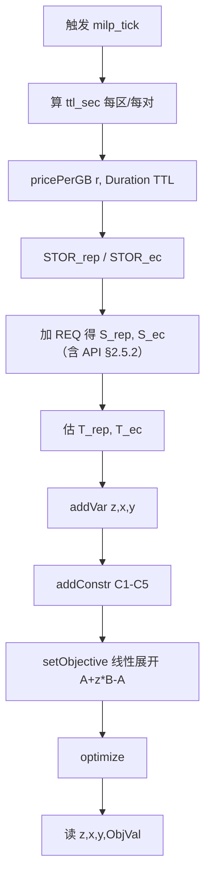
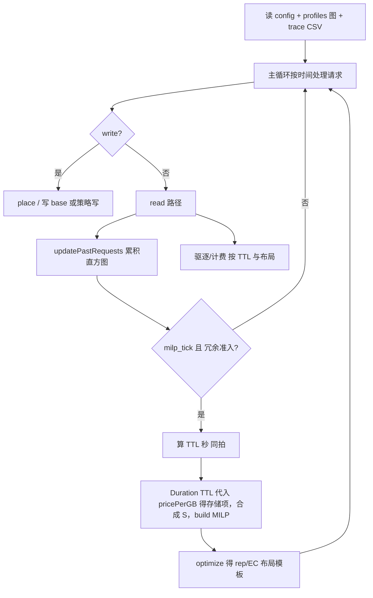

# PolicyMilpECnewV3：Gurobi MILP 线性规范（可落地版）

> **计费「人话」、API 与仿真对账、直方图为何不按 EC 分片污染用户特征**：见 **`docs/Simulation_Cost_API_Histogram_EC.md`**（必读）。  
> **硬性要求**：MILP 系数中的 **\(\mathrm{REQ}\)** 必须 **显式包含** 与仿真 **`pricePut`/`priceGet`** 对齐的 **API 边际**；**仅含存储+带宽、不含 API** 的目标与 **真实云存储 trace 仿真** 不可对账，视为 **建模/实现错误**。

> **定位**：本文从 `docs/PolicyMilpECnewV3_Design.md` 抽出 **公式 + 变量 + 输入输出 + 伪代码 + 流程图**，用 **人话** 写，便于直接对着写 `PolicyMilpECnewV3` + Gurobi。  
> **硬性规定（V3 实现约定）**：**在同一触发节拍上，先按 `PolicyTevictRangesNew` 路径得到 TTL（秒），再把该 TTL 当作 MILP 里计算存储边际的「时间」`time`，与 `size`、`priceStorage` 一起生成 \(S\) 系数；再解 MILP。**（与「仿真里用真实 duration 结账」可并存：MILP 用 **TTL 作为规划驻留时间**。）

---

## 0. 「聚合单元」用人话怎么说？

### 超短版（先看这段）

- **问题**：对象太多，**不能每个文件都算一遍「放哪省钱」**（算不过来）。  
- **做法**：**按「地区」或「地区+小大文件」分几堆**，**每一堆只算一次**，算出来的结果 **这一堆里的文件都先用着**。  
- **「聚合单元」**：就是 **上面说的「那一堆」**——**一堆算一次**里的 **「一堆」**。

**别记术语**：你就记 **「一堆一批」**；文档里写成「聚合单元」四个字而已。

---

### 稍微展开（仍不说黑话）

| 你脑子里可以换成 | 文档里写的 |
|------------------|------------|
| **哪个区发起的读**（比如总在 regB 上读） | 常作为 **「这一堆」的分法**（`issueRegion = regB` 算一批） |
| **这一批共用的那一次计算结果** | **一次 MILP** 出来的「副本放哪 / EC 三片放哪」 |
| **用来代表这一批有多大的那个文件**（算钱用） | **`size_logic_GB` 用的模板大小**（常取这批里某个对象的 `LogicalObject` 大小） |

**再打个比方**：  
全校 **不按每个学生订食堂套餐**，而是 **按年级订一种套餐**——**「高一」就是一个堆**，**「高二」又是一个堆**。这里的 **「年级」** 就像 **issueRegion（或再乘文件大小档）**；**「聚合单元」= 某个年级（或某年级里的某档大小）**。

---

### 原文档表述（对齐设计用）

**一句话**：**「一批对象共用同一次 MILP 结果」时，用来分组的那个「桶」或「标签」**——不是某一个对象，而是 **你规定**「哪几条对象算一伙」。

**再具体一点**：  
仿真里可能有 **几百万个 `obj_key`**；若 **每个对象都单独解一次 MILP**，会卡死。所以做法是：**按某个键把对象归堆**（例如 **都按「热点区 = regB」**、或 **按「小文件桶」**），**每一堆只解一次 MILP**，得到一个 **布局模板**（副本多放哪、EC 三片落哪），**这堆里的新对象先照模板走**，直到下次刷新再重算。  
**这个「一堆」在文档里就叫「聚合单元」**。

**在实现里它通常是什么**：  
最常见是 **一个「issueRegion」**（或 region 再乘大小桶）——**一个键对应一次 MILP**。键怎么定，**必须写死在代码/配置里**（例如 `aggregateKey = issueRegion`）。

**替代说法**：**分组键**、**MILP 一批**、**模板组**。

---

### 0.1 本设计中的操作定义：聚合单元 **具体指什么**（才能算指标给 MILP）

下面是一条 **可写进代码** 的约定：**「聚合单元」在本规范里 = 一个确定的「键」+ 该键下 **取数** 的规则**。不是比喻。

#### （1）默认定义（本规范 **定稿**）

| 项目 | 取值 |
|------|------|
| **聚合单元的键（唯一标识）** | **`issueRegion`**：与仿真里 **`Request.issueRegion`** 相同的那个 **region 字符串**（**发起读/写请求所在区**）。 |
| **一次 MILP 与键的对应** | **同一 `milp_tick`（同一触发节拍）内，每个 `issueRegion` 至多调用一次 `optimize()`**——即 **一次求解 = 一组「(milp_tick, issueRegion)」**。 |
| **它不是什么** | **不是**单个 `obj_key`；**不是**全局一次不分区；**不是**直方图里的「间隔桶编号」本身（桶号要映射到 GB 才有意义）。 |

**人话**：**「按哪个区当热点来分」**——**每个热点区（发起读的那边）单独算一次布局**，避免全 trace 混在一起算。

#### （2）该键下，给 MILP 的 **指标从哪来**（与 §2 对齐）

| 给 MILP 的量 | 在本规范默认下 **如何绑定到 `issueRegion`** |
|----------------|-----------------------------------------------|
| **`size_logic_GB`** | 取 **本拍** 为该 `issueRegion` 选定的 **模板** `LogicalObject` 的 **`getSize()`→GB**（见 §2.2；典型：**触发本拍 MILP 的那条请求** 对应 `objKey` 的 `LogicalObject`）。 |
| **`ttl_sec[r]`**（对每个 \(r\)） | **仍按区域** 调 `getTevict` / 直方图；**dst / issueRegion 与 `PolicyTevictRangesNew` 一致**。**触发本拍 MILP 的上下文** 用当前单元的 **`issueRegion`** 作为「以谁为 issue 的读」侧（与源码 `calculateTtl` / `getTevict(src, dst)` 的写法对齐，**src/dst 规则在实现里写死一种**）。 |
| **直方图 / REQ 分摊** | 使用 **与该 `issueRegion` 相关** 的统计：在现有仿真里，**`updatePastRequests(request, placeRegion)`** 的 **`placeRegion`** 与 **`request.issueRegion`** 在 **read** 路径上 **一致** 时，本拍累积的 **即该 issue 侧的访问统计**；若策略按 **issueRegion** 聚合窗口内 **读/写字节与次数**，则 **REQ 分项** 与该键一致。 |
| **`T_rep` / `T_ec`** | 在 **同一 `issueRegion`** 下、**同一模板体量** 与 **假设路由** 下预计算的两个常数（见设计文档 §10.3.3 链 2）。 |

**小结**：**聚合单元 = 以 `issueRegion` 为键的一条「求解批次」**；**所有进 MILP 的标量系数，都必须在代码里能说明「是为哪一个 `issueRegion` 这一拍算的」**。

#### （3）可选扩展（若实现启用）

- **键升级为 `(issueRegion, size_bucket_id)`**：则 **聚合单元 = 热点区 + 大文件/小文件档**；**一次 MILP** 由 **`(milp_tick, issueRegion, size_bucket_id)`** 唯一确定；**体量** 取该桶的 **代表 GB**（§2.2 备选 B）或 **桶内中位数**（备选 A）。  
- **未启用时**：不要混用；**默认只认 `issueRegion`**。

#### （4）与数学模型里的 \(\mathcal{R}\) 的关系

- **一个聚合单元** 仍对应 **一套** \(z,x_r,y_{r,k}\)（**全局所有 region 参与** 同一次布局决策）。  
- **`issueRegion`** 只决定 **「这次是为哪条流量热点做决策」**、**系数从哪套统计与模板对象来**，**不是**把 \(\mathcal{R}\) 拆成多个互不相干的小 MILP（除非实现显式改成多问题）。

---

## 1. 集合与索引

| 符号 | 含义 |
|------|------|
| \(\mathcal{R}=\{0,\ldots,n-1\}\) | 区域下标（与 `Config.regions` / `DiGraph` 节点顺序 **一致**） |
| \(b\in\mathcal{R}\) | Fixed-Base 基底区下标 |
| \(k\in\{1,2,3\}\) | EC(2+1) 三片编号（2 数据 + 1 校验，**逻辑片号**） |

---

## 2. 外部输入（不进 Gurobi 变量，只作常数/系数）

### 2.1 图与价目（来自 `DiGraph`）

| 名称 | 类型 | 含义 |
|------|------|------|
| `priceStorage[r]` | `double` | 节点 `r` 的存储价（与现有 `RegionManager.pricePerGB` 约定一致，见仓库实现） |
| `edgeCost[u][v]` | `double` | 边传输单价/权重（与现有 `cost` 一致；**按字节计费**） |
| **`pricePut[r]`** | **`double`** | **必选**，与仿真 `DiGraph` 节点属性一致：**对该 region 计一次 PUT 类 API 的固定费**（**不乘 size**） |
| **`priceGet[r]`** | **`double`** | **必选**，与仿真一致：**对该 region 计一次 GET 的固定费**（**不乘 size**） |

**与仿真的关系**：`SimulatorV2` / `simulator_v2.py` 对 **放置到的每个 region** 累加 **`pricePut`**，读路径上按实现累加 **`priceGet`**；MILP 中 **API 边际**必须使用 **同一组** `pricePut`/`priceGet`，否则 **优化目标 ≠ 仿真账本**。

### 2.2 聚合单元体量（本拍 MILP 服务的对象）

| 名称 | 类型 | 含义 |
|------|------|------|
| `size_logic_GB` | `double` | 聚合单元代表对象的 **逻辑大小（GB）**（整对象） |
| `size_shard_GB` | `double` | EC 下单片有效大小；**约定** `size_shard_GB = size_logic_GB / 2`（EC(2+1) 的 `kData=2`；单片按数据片等分） |

**体量来源：具体用哪个指标？（须实现时写死一种，并打日志可复现）**

| 优先级 | 指标（仓库内） | 说明 |
|--------|----------------|------|
| **推荐（默认）** | **`LogicalObject.getSize()`** → 除以 **`Definitions.GB`**（或 `1024^3`）得 **`size_logic_GB`** | 与本仿真 **`PhysicalObject` / 计费** 一致：**逻辑对象字节大小**。聚合键为 **region**（或 region×桶）时，取该单元选定的 **「模板对象」**（例如 **本拍触发 MILP 的那条请求** 对应的 `objKey`，或 **该 region 上最近一次冗余相关对象的 LogicalObject**）。 |
| **备选 A** | 同一聚合单元内、统计窗口内的 **`Request.size`** 的 **中位数 / 均值 / P90**（字节 → GB） | 适合「一单元内多对象、大小差异大」：避免被单点对象绑架；**指标名称**在实现里固定为例如 **`median_size_bytes_in_unit`**。 |
| **备选 B** | 价目/策略规定的 **固定档位**（如 small/medium/large 对应 GB） | 与 **大小桶** 策略一致时，**`size_logic_GB`** = 该桶 **代表值**（上界或桶中点）。 |

**不推荐**：用 **直方图桶索引** 代替字节（桶只表示 **间隔**，不是 GB）；若只有桶，须 **映射到 GB** 再进 MILP。

**与 trace 的对应关系**：CSV / 请求里对象体积来自 **`Request.size`**（`BigDecimal` 字节），写入 **`LogicalObject`** 后长期以 **`LogicalObject.getSize()`** 为准；**`size_logic_GB`** 应对齐 **这两者之一**，不要与 **传输计费用的分片大小** 混用 unless EC 路径显式换算。

### 2.3 TTL（秒）——**本规范规定与 MILP 同拍计算**

| 名称 | 类型 | 含义 |
|------|------|------|
| `ttl_sec[r]` | `double` | 区域 \(r\) 用于 **存储边际** 的 TTL（**秒**）。**来源**：与 `PolicyTevictRangesNew.getTevict(...)` / `calcEvictCost`+`findMin` **同一套调用**在本触发时刻得到的值（对 **issueRegion=r** 或策略规定的 `(src,dst)`，**实现须写死一种映射**）。 |

**换算为「天」供与 `RegionManager.pricePerGB(region, duration)` 对齐：**

\[
\tau_r^{\mathrm{days}} = \frac{\texttt{ttl\_sec}[r]}{86400}.
\]

### 2.4 存储边际系数（**size × time × price**，其中 **time = TTL**）

**与仓库 `RegionManager` 一致**：`pricePerGB(region, duration)` 返回的是 **「1 GB 在 duration 这段时长内的存储费」**（内部用 `priceStorage`×月换算 × **天数 = ttl_sec/86400**）。整副本：

\[
\boxed{
\mathrm{STOR}^{\mathrm{rep}}_r
= \texttt{size\_logic\_GB} \times \texttt{pricePerGB}\bigl(r,\ \texttt{Duration.ofSeconds}(\texttt{ttl\_sec}[r])\bigr)
}
\]

**注意**：Java 里若 `pricePerGB` **已经**是「每 1 GB 的总价」，则 **不要再乘一次 1GB**；实现上等价于 **`multiply(sizeInGb)`**（见 `RegionManager`：`cost = pricePerGbForDuration.multiply(sizeInGb)`）。

**EC 单片**（`size_shard_GB = size_logic_GB / 2`）：

\[
\mathrm{STOR}^{\mathrm{ec}}_{r,k}
= \texttt{size\_shard\_GB} \times \texttt{pricePerGB}\bigl(r,\ \texttt{Duration.ofSeconds}(\texttt{ttl\_sec}[r])\bigr)
\]

（若三片落在不同 region，**各片用该片所在区的 `ttl_sec[thatRegion]`**。）

### 2.5 合成 \(S\) 与 \(T\)（进入目标函数的标量）

\[
S^{\mathrm{rep}}_r = \mathrm{STOR}^{\mathrm{rep}}_r + \mathrm{REQ}^{\mathrm{rep}}_r,\qquad
S^{\mathrm{ec}}_{r,k} = \mathrm{STOR}^{\mathrm{ec}}_{r,k} + \mathrm{REQ}^{\mathrm{ec}}_{r,k}.
\]

- \(\mathrm{REQ}^{\cdot}\)：由 **直方图预测的读/写强度**（见 **§2.5.1**、**§2.5.2**）在本聚合单元上 **分摊** 到「若副本在 \(r\) / 若片 \(k\) 在 \(r\)」的边际（**常数**，本拍固定）。  
- \(T^{\mathrm{rep}}\)、\(T^{\mathrm{ec}}\)：**纯传输**（边 `cost`×字节）及设计文档规定的 **链路费**；**不要把 API 塞进来重复计**（API 在 **§2.5.2**）。

**本规范唯一强约束**：\(\mathrm{STOR}^{\cdot}\) 里的 **duration** 一律取 **`Duration.ofSeconds(ttl_sec[·])`**，且 **`ttl_sec`** 与 **本拍 MILP 触发前**算出的 **TevictRanges TTL（秒）** 同源。

---

#### 2.5.1 直方图预测用什么「次数/字节」？（与 EC 分片无关）

**人话**：直方图是 **用户对逻辑对象的历史访问统计**，用来 **猜以后用户怎么访问**；**不是**「系统内部存了几片」的统计。  
因此 \(N_w^{\mathrm{pred}}\)、\(N_r^{\mathrm{pred}}\)（及与 \(\mathrm{REQ}^{\mathrm{net}}\) 相关的字节预测）一律用 **逻辑请求/逻辑体量** 的尺度，**不把 EC 分片次数/分片字节混进「用户行为预测」**，避免 **污染访问模式特征**（详见 **`Simulation_Cost_API_Histogram_EC.md` §3**）。

---

#### 2.5.2 API 边际（**必选**；与仿真 `pricePut`/`priceGet` 对账）

令 \(N_w^{\mathrm{pred}}\)、\(N_r^{\mathrm{pred}}\) 为本聚合单元在规划窗内对 **逻辑写、逻辑读** 次数（或等价强度）的预测，**与 §2.5.1 同一套直方图口径**。令 \(P^{\mathrm{put}}_r=\texttt{pricePut}[r]\)，\(P^{\mathrm{get}}_{\mathrm{issue}}=\texttt{priceGet}[r_{\mathrm{issue}}]\)（**issueRegion** 即本单元键，见 §0.1）。

**多副本（\(z=0\)）**：与仿真「每有一个放置副本的 region，逻辑写会各触发一次该区 `pricePut`」对齐，将 API 部分并入 \(\mathrm{REQ}^{\mathrm{rep}}_r\)：

\[
\mathrm{REQ}^{\mathrm{rep}}_r
= \underbrace{\mathrm{REQ}^{\mathrm{net}}_r}_{\text{原网络/其它分项}}
\ +\ \underbrace{N_w^{\mathrm{pred}}\, P^{\mathrm{put}}_r}_{\text{PUT API，与 } x_r \text{ 同现}}
\ +\ \text{（读侧 GET 若按区计，可进常数项或 } T^{\mathrm{rep}}\text{，与实现一致即可）}.
\]

**EC(2+1)（\(z=1\)）**：与仿真「三片落三个 region → **三次** `pricePut`」对齐，**每个** \((r,k)\) 一片对应一次 PUT API：

\[
\mathrm{REQ}^{\mathrm{ec}}_{r,k}
= \mathrm{REQ}^{\mathrm{net,ec}}_{r,k}
\ +\ N_w^{\mathrm{pred}}\, P^{\mathrm{put}}_r
\quad\text{（该式乘在 } y_{r,k}\text{ 上进入目标）}.
\]

**逻辑读 GET（单点记账约束）**：每次逻辑读只计一次 \(P^{\mathrm{get}}_{\mathrm{issue}}\)。  
实现需在“候选比价层”与“常数项层”二选一，不得重复计。  
若放入常数项，则  
\(\mathrm{API}^{\mathrm{get}} = N_r^{\mathrm{pred}}\, P^{\mathrm{get}}_{\mathrm{issue}}\)  
加入 \(T^{\mathrm{rep}}\) 与 \(T^{\mathrm{ec}}\)；若在 runtime 请求层计费，则 \(T\) 中不再重复加入。

**缺失 API 项的后果**：与 trace 回放累计的 **request cost** 维度 **长期对不齐**，**不得**称为「仿真真实云存储场景下的最优布局」——**须在实现中修复**。

---

## 3. Gurobi 决策变量（逐一定位）

| 代码名 | 数学 | 类型 | 取值 | 含义 |
|--------|------|------|------|------|
| `z` | \(z\) | `GRB.BINARY` | \(\{0,1\}\) | **1**=EC(2+1)，**0**=多副本 |
| `x[r]` | \(x_r\) | `GRB.BINARY` | \(\{0,1\}\)，\(\forall r\in\mathcal{R}\) | **1**=在区域 \(r\) 放 **完整副本** |
| `y[r][k]` | \(y_{r,k}\) | `GRB.BINARY` | \(\{0,1\}\)，\(\forall r,k\) | **1**=第 \(k\) 片在区域 \(r\) |

**变量个数**：\(1 + n + 3n = 1 + 4n\)（\(n=|\mathcal{R}|\)）。

---

## 4. 线性约束（与 §10.3 一致）

对 \(\forall r\in\mathcal{R},\ \forall k\in\{1,2,3\}\)：

\[
\begin{aligned}
& x_r \le 1-z, \quad y_{r,k} \le z \\
& \sum_{r} x_r \ge 1-z,\quad x_b \ge 1-z \\
& \sum_{r} y_{r,k} = z \quad (\forall k),\quad \sum_k y_{r,k} \le z \quad (\forall r) \\
& \sum_{k=1}^3 y_{r,k} \le 1 \\
& x_r + \sum_{k=1}^3 y_{r,k} \le 1
\end{aligned}
\]

---

## 5. 目标函数（线性）

\[
\min\ \ (1-z)\Big(\sum_{r} S^{\mathrm{rep}}_r x_r + T^{\mathrm{rep}}\Big)
\ +\ z\Big(\sum_{r,k} S^{\mathrm{ec}}_{r,k}\, y_{r,k} + T^{\mathrm{ec}}\Big).
\]

其中 **\(S^{\mathrm{rep}}_r\)、\(S^{\mathrm{ec}}_{r,k}\)** 已按 **§2.5** 含 **存储 + 网络 REQ + API（§2.5.2）**；**\(T^{\cdot}\)** 仅含未在 runtime 重复记账的常数项。**若某实现版本遗漏 §2.5.2 或重复计 GET**，目标与 **仿真 request cost** 不对账。

**Gurobi**：`GRB.MINIMIZE`，`LinExpr` 对 `z` 用 **仿射技巧**（见伪代码：展开为四项或引入辅助式）。

---

## 6. 求解器输出（读回）

| 输出 | 含义 |
|------|------|
| `z.X` | 布局模式：0 或 1 |
| `x[r].X` | 各区是否放整副本 |
| `y[r][k].X` | 片 \(k\) 是否落区 \(r\) |
| `ObjVal` | 目标值（本拍总成本近似） |

---

## 7. 伪代码（建模型 + TTL→存储→系数）

```text
输入: regions[0..n-1], baseIndex b, size_logic_GB, 价目与图, 直方图聚合出的 REQ 分项, 传输估计 T_rep, T_ec
输出: z, x[], y[][], ObjVal

// 1) 与 MILP 同拍：先算各 region 的 TTL（秒）——调用 PolicyTevictRangesNew 路径
for r in 0..n-1:
    ttl_sec[r] = getTevictForRegionOrPair(r, currentTimestamp)   // 实现定义：src/dst 如何选

// 2) 用 TTL 作 duration，算存储边际（与 RegionManager 一致：总价 = pricePerGB(r,dur) * sizeGB）
for r in 0..n-1:
    dur = Duration.ofSeconds((long) ttl_sec[r])
    STOR_rep[r] = size_logic_GB * pricePerGB_node(r, dur)   // 与 RegionManager.pricePerGB 同语义
    for k in 1..3:
        STOR_ec[r][k] = size_shard_GB * pricePerGB_node(r, dur)

// 3) 合成 S（REQ 必须含 §2.5.2：N_w^pred * pricePut 等与仿真对账的 API 边际）
S_rep[r] = STOR_rep[r] + REQ_rep[r]   // REQ_rep 含 REQ_net + N_w^pred * pricePut[r] 等
S_ec[r][k] = STOR_ec[r][k] + REQ_ec[r][k]   // REQ_ec 含每片 API：N_w^pred * pricePut[r]

// 4) Gurobi
model = new GRBModel(env)
z = model.addVar(0.0, 1.0, 0.0, GRB.BINARY, "z")
for r: x[r] = model.addVar(0.0, 1.0, 0.0, GRB.BINARY, "x_"+r)
for r,k: y[r][k] = model.addVar(0.0, 1.0, 0.0, GRB.BINARY, "y_"+r+"_"+k)

添加约束 C1..C5（见第 4 节）

obj = new LinExpr()
// 目标 = (1-z)*(sum S_rep[r]*x[r] + T_rep) + z*(sum S_ec[r][k]*y[r][k] + T_ec)
// 线性展开：令 A = sum S_rep*x + T_rep, B = sum S_ec*y + T_ec，则 (1-z)*A + z*B = A + z*(B-A)

model.setObjective(obj, GRB.MINIMIZE)
model.optimize()

读取 z, x, y, ObjVal
```

---

## 8. 流程图：单次 MILP（Gurobi）



---

## 9. 全流程：从读数据集到策略闭环（人话）



**人话**：先 **读配置和价目图**，再 **按 trace 回放**；**读请求** 更新直方图；到了 **该算 MILP 的节拍**，**先算 TTL**（和平时给副本贴标签同源），**再用 TTL 当「要收多少天存储费」的时间**，把 **存储边际** 算进 \(S\)，**最后 Gurobi 只选 0/1 布局。

---

## 10. 输入 / 输出清单（实现验收）

| 方向 | 内容 |
|------|------|
| **入** | `regions`, `b`, `size_logic_GB`, 价目/边权, **`pricePut[]`/`priceGet[]`（与仿真同源）**, 直方图聚合的 \(N_w^{\mathrm{pred}},N_r^{\mathrm{pred}}\) 及 REQ 网络分项, `T_rep`, `T_ec`, 时间戳 |
| **入（本规范强约束）** | 同拍 **`ttl_sec[r]`**（来自 TevictRanges TTL 路径） |
| **出** | `z`, `x[]`, `y[][]`, `ObjVal`；以及供仿真使用的 **布局模板** |

---

## 11. 与主设计文档的关系

- 数学结构：**§10.3**（`PolicyMilpECnewV3_Design.md`）。  
- **本文新增**：变量与 **Gurobi 类型**一一对应；**TTL 与 MILP 同拍**；**存储系数显式用 TTL 作 time**。  
- 若 **`getTevict` 12h 缓存** 导致 TTL 与直方图不同步，行为以 **源码** 为准；可在实现日志中 **同时打印** `ttl_sec` 与 `S_rep` 便于对账。

**实现类/方法/仿真器对接**：见 **`docs/PolicyMilpECnewV3_CodeDesign.md`**。
