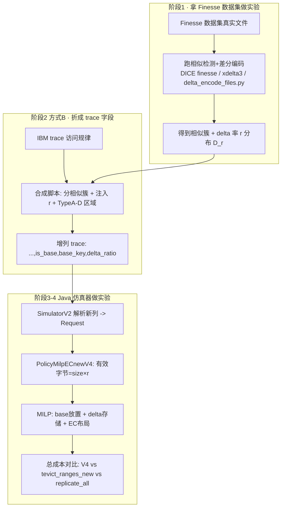

# PolicyMilpECnewV4 设计文档（相似检测 + 差分编码 + EC + MILP）

> 规格驱动开发（Spec-Driven）。本文是 **V4 的设计规格**，先定义"做什么/为什么/接口/数据模型/成本模型/实验口径"，再据此实现代码。
>
> **一句话**：V4 = 在 V3（MILP 在 Replicate vs EC(2+1) 间求总成本最低）基础上，**把 Finesse 式「相似检测 + 差分编码」融入成本模型**——相似对象只存/传 delta（按实测压缩率 r 缩小有效字节），MILP 再据此决定 base 放置、delta 存储与 EC 布局，从而进一步降低总成本。
>
> **与 V3 关系**：MILP/EC(2+1)/TTL/Histogram/Cost-Optimal 的内核**沿用 V3**（见 `docs/PolicyMilpECnewV3_Design.md` §10、`PolicyMilpECnewV3_Gurobi_Spec.md`）。本文只写 **V4 的增量**：相似/版本结构、delta 有效字节、base 可用性约束、以及配套的离线测量与多云合成实验。

---

## 1. 背景与动机（为什么需要 V4）

### 1.1 V3 在当前 trace 上的结构性结论

- SkyStore 的成本模型里，每个放置区域的成本 = **存储项**（`size × 时长 × 存储单价`）+ **传输项**（`size × 边费率`），见 `PolicyMilpECnewV3.buildCoefficients`（342–352 行）。
- 在 IBM Object Store trace（write-once、人均读 ~1.7 次、对象互不相同）上，**传输项相对存储项占比过高**，EC 把 `size` 降为 `size/K` 带来的存储节省，被"读/重建时跨区取分片"的传输代价吃掉 → **MILP 几乎恒选全副本**。

### 1.2 delta 的切入点（数学上为何能翻盘）

delta 编码不改变 EC 分片逻辑，它改变成本公式里的 **`size`**：相似对象只需存/传 **delta（差值）**。当 `size → size × r`（r = delta 压缩率，相邻版本常 < 0.1）：

- 写入与重建的**传输项**显著变小；
- EC 那个一直拖后腿的"跨区取分片"代价被压低 → **EC 的存储节省得以净胜全副本**。

> 结论：**delta 攻击传输项里的 `size`，EC 攻击存储项**，两者作用在公式不同因子上、可叠乘、不冲突。这是"Finesse + EC"在本系统成立的根本理由。

### 1.3 数据现实（已实测，决定方法学）

| Trace | 唯一 key | 重写 key 数 | 是否含天然版本/相似 |
|---|---|---|---|
| T015 | 671,582 | 4 | 否（write-once） |
| T029 / T065 / T079 | — | 0 | 否 |
| T078 | 91,176 | 26,800（~29%） | 部分有重写 |

**IBM trace 不含内容、绝大多数无版本/相似结构**，无法直接做相似检测。故 V4 的相似性/压缩率必须来自 **真实文件的离线测量**，再以 **方式 B** 合成到工作负载里（§5）。

---

## 2. 目标与非目标

### 2.1 目标（V4 必须做到）

1. **R1 相似/版本结构**：逻辑对象可标记为 **base（全量）** 或 **delta 成员（相似于某 base）**，并携带实测 **delta 压缩率 r**。
2. **R2 成本模型融合 delta**：MILP 系数中，delta 成员的存储/传输有效字节 = `size × r`；base 按全量。
3. **R3 base 可用性约束**：delta 成员可读 ⇔ 其 base 可达；MILP 不得给出"省钱但读不出"的解。
4. **R4 EC 与 delta 协同**：在 delta 之上仍可选 EC(2+1)（对 base 或 delta 做条带），由 MILP 求总成本最低。
5. **R5 基线零影响**：新增字段/配置对 `tevict_ranges_new`、`replicate_all` 等基线**完全透明**（不读即不变）。
6. **R6 可复现实验**：能跑 `delta+EC+MILP(V4)` vs `tevict_ranges_new` vs `replicate_all` 的**总成本比例**对比。

### 2.2 非目标（V4 不做）

- 不在仿真器里做**字节级**相似检测/差分编码（仿真只有字段，无内容）；相似检测+delta 在 **Finesse 数据集上一次性跑出**，仿真只消费其**相似簇结构 + 压缩率 r**。
- 不改 SkyStore 的 Rust 真实系统（其 delta/EC 未实现；成本对比走仿真器，与 SkyStore 论文同口径）。
- 不改 V3 的 EC(2+1) 片数、互斥约束、TTL/驱逐语义（沿用）。

---

## 3. 术语

| 术语 | 含义 |
|---|---|
| **base（基准对象）** | 完整存储的逻辑对象，作为 delta 的参照；映射到 V3 的 `fixedBaseRegion` FB 主副本。 |
| **delta 成员** | 与某 base 高度相似的对象，只存/传差值；有效字节 = `size × r`。 |
| **delta 压缩率 r** | `|delta| / size(目标对象)`，由离线 `xdelta3`/finesse 实测，r∈(0,1]，越小越相似。 |
| **相似簇（cluster）** | 一个 base + 若干 delta 成员的集合（方式 B 合成的相似单元）。 |
| **D_r** | 离线测得的 delta 压缩率经验分布（合成时抽样用）。 |
| **方式 B** | 用真实文件测 r 分布，再以 r 为参数/抽样注入合成工作负载（§5）。 |
| **DCR / DCE** | Finesse 指标：Delta Compression Ratio / Efficiency（离线工具输出，用于校准 r）。 |

---

## 4. 系统总览（数据流）



**做法定位**：**对象总体 = Finesse 真实数据集**（内容/大小/相似簇/压缩率都来自真实文件，不是拍脑袋的常数）；**访问层 = 合成**（时间/读频/区域借 IBM trace 规律 + SkyStore Type A-D，与 SkyStore 论文自身"用真实对象 + 合成多云访问"的做法同源）。换句话说：**不是单独做一个"离线测量"研究，而是把 Finesse 数据集当实验对象，把它的相似/delta 特征折算成 trace 字段，再在仿真器里跑成本对比。**

---

## 5. 方法学：方式 B（相似簇合成）

### 5.1 为什么是"相似簇"而非"时间版本链"

delta 成本模型只需 **base + delta 成员 + r**。两种来源：

| | 含义 | 对 trace 改动 | 选用 |
|---|---|---|---|
| **方案 I 相似簇（采用）** | 把 p% 不同对象分组，组内 1 base + 若干 delta 成员 | **不增删行**，仅追加列 | ✅ 符合"在原记录上加维度、不影响基线" |
| 方案 II 时间版本链 | 同 key 注入多次 PUT 形成 v1→v2→v3 | 需新增行、改访问量 | ❌ 破坏行数/访问规律 |

采用 **方案 I**：行数、时间、size、访问区域全部不变 → 基线策略读不到新列，结果与现状完全一致。

### 5.2 合成步骤（阶段 2 脚本）

1. 扫描 trace，收集 distinct `obj_key`。
2. 按比例 `p` 选入相似簇；簇大小从分布抽样（如 2–8）。
3. 每簇：1 个 `is_base=1, delta_ratio=1.0`；其余 `is_base=0, base_key=簇base, delta_ratio` 从 **D_r** 抽样。
4. 未入簇 key：`is_base=1, delta_ratio=1.0`（等价普通对象）。
5. PUT/GET 行都带上该 key 的簇信息，逐行回写。

### 5.3 多云访问层（Type A–D，沿用 SkyStore）

- **Type A 均匀** / **B 区域感知** / **C 聚合** / **D 复制**：决定每个对象的 PUT/GET region 分配。
- 访问时间线借 IBM trace 的到达间隔/recency/读频（或 SkyStore 的"一天扩一月"）。

---

## 6. 数据模型变更

### 6.1 trace 列（追加在末尾，基线忽略）

```
timestamp,op,issue_region,obj_key,size,time_to_next_access,time_to_next_access_same_reg,is_base,base_key,delta_ratio
```

- `is_base`：1=base，0=delta 成员。
- `base_key`：delta 成员所属 base 的逻辑 key（base 行可空或自身）。
- `delta_ratio`：delta 成员的实测压缩率 r；base 为 1.0。
- **兼容性**：旧 trace 无这三列时，解析默认 `is_base=1, base_key=null, delta_ratio=1.0`（行为退化为 V3）。

### 6.2 `Request.java`（+3 字段）

```java
public boolean isBase = true;
public String baseKey = null;
public double deltaRatio = 1.0;
```

### 6.3 `LogicalObject.java`（+2/3 字段）

```java
public boolean isBase = true;
public String baseKey = null;
public double deltaRatio = 1.0;   // 写入时从 Request 落入，供 MILP template 读取
```

### 6.4 `Config.java`（+开关，默认 false 保证基线零影响）

```java
public Boolean deltaEnabled = false;        // 仅 milp_ec_new_v4 打开
public Double  deltaShardRatio = null;       // 【已定】保持 null：EC 分片按 size×r/K，不二次 delta（见 §7.2）
```

> 解析新列与字段落入仅在 `deltaEnabled=true` 路径生效；基线策略不触碰，字节级一致。

---

## 7. 成本模型（相似 MILP EC）

### 7.1 V3 系数回顾

对区域 r（`buildCoefficients`）：
```
storRep   = storageCostGb(sizeLogicGb,  ttl[r])
storShard = storageCostGb(sizeShardGb,  ttl[r])      // sizeShardGb = sizeLogicGb / K_DATA
xferRep   = edgeCost(issue, r) × sizeLogicGb
xferShard = edgeCost(issue, r) × sizeShardGb
sRep[r]   = storRep   + xferRep
sEc[r][k] = storShard + xferShard
```

### 7.2 V4 增量：delta 成员乘 r

设对象有效逻辑字节 `sizeEffGb = isBase ? sizeLogicGb : sizeLogicGb × deltaRatio`，则：

```
storRep   = storageCostGb(sizeEffGb,           ttl[r])
storShard = storageCostGb(sizeEffGb / K_DATA,  ttl[r])
xferRep   = edgeCost(issue, r) × sizeEffGb
xferShard = edgeCost(issue, r) × (sizeEffGb / K_DATA)
```

- **base 对象**：`deltaRatio=1.0` → 与 V3 完全相同（且仍受 `fixedBaseRegion` FB 钉住、按完整 horizon 计存储）。
- **delta 成员**：存储项与传输项**同时**按 r 缩小。

### 7.3 写路径放置字节（`getPlacementWithSizes`，158 行）

delta 成员写入落盘量同样乘 `deltaRatio`；EC 模式每片 = `size × deltaRatio / K_DATA`。

### 7.4 读路径恢复代价——delta×EC 叠加，二阶口径（已定）

> **实现位置（已修订）**：§7.4 的成本**主路径**在 `CheapestTransferV3.buildDeltaReadPath`：为 delta 成员显式构造 **patch hop + (base 远程时) base hop** 两段 transfer graph，按 **每段 `edgePrice × bytes`** 计费——避免旧实现里"patch 本地命中→`dst→dst` 零价边把远程 base 代价抹成 \$0"的低估。`PolicyMilpECnewV4.getReadTransferSize` 退化为**单图回退**口径（base 未放置等罕见情形），与主路径一致。回归测试：`CheapestTransferV3DeltaReadTest`。


**核心认识**：delta 与 EC 是 **两层独立编码**，读 delta 成员 B 时要分别"还原"：
- **delta 层**：`B = decode(base A, patch)` → 必须先拿到 **A**，再拿 **patch**；`decode` 只费 CPU，不计传输。
- **EC 层**：被 EC 的那一方（A 或 patch）要 **取 K 片重建**。

因此读恢复传输 = **取 patch 的代价** + **取 base 的代价**。**patch 极小（`r·V`），base 是全尺寸 `V` → base 才是贵的一头。**

**恢复代价矩阵**（读成员 B @ region g；V=base 大小，r=成员 delta 率，K=数据片数）：

| base 状态 | patch 状态 | 读恢复传输 bytes |
|---|---|---|
| base 在 g 有本地副本 | 本地 | ≈ 0（仅 decode） |
| base 在 g 有本地副本 | 远程副本 | `r·V`（取 patch） |
| base 在 g 有本地副本 | EC | `K 片 × (r·V/K) = r·V`（重建 patch，极小） |
| **base 被 EC 到其它区** | 任意 | `≈ V`（取 K 片重建整个 base，**贵**） |
| base 仅远端整副本 | 任意 | `≈ V + r·V ≈ V`（拉 base，**贵**） |

```
readBytes(成员 B @ g) = patchBytes(g) + baseBytes(g)
  patchBytes(g) = baseLocalPatch ? 0 : r·V        // patch 小，可忽略量级
  baseBytes(g)  = baseLocal(g) ? 0
                : baseIsEC      ? Σ_K shard(V/K)   // 重建整 base ≈ V
                : V                                 // 远端整副本拉取 ≈ V
```

**关键结论（你问的"恢复代价"）**：**delta 只有在 base 离读者近时才省钱**；若把 base EC 到远区，则每次读任一成员都要 **重建整个 base ≈ V**，delta 省下的传输被 base 重建吃回去。

**base 摊销**：base 在 g 重建/拉取一次后留本地，则该区 **所有成员的读 + 重复读** 都只付微小 patch 钱。故"在 g 留一份 base"是 **多花一份 base 存储** 换 **该区 delta 读几乎免费** 的买卖——这正是 §7.7 MILP 要权衡的。

- **该恢复 bytes/路径必须与运行时 transfer policy 完全一致**（沿用 V3 §10.7.1 第 3 条：任一侧改动需同步另一侧 + 回归用例）。

### 7.5 base 可用性约束（R3，新增）

- delta 成员的 base 必须存在一份**可达**副本/EC 组（FB 模式下 base 主副本天然不被驱逐，已满足）。
- MILP 侧：保证 delta 成员被选中放置时，其 base 的 FB 项已计入（base 的存储成本按完整 horizon，sigma 复用 V3 `fbConst`）。
- **delta 链长度**（可选约束）：限制连续 delta 不超过 L，超过则强制重新 base，防止读放大。

### 7.6 MILP 数学（在 V3 §10.3 上的最小扩展）

变量/约束（C1–C5）/目标**沿用 V3**；唯一变化是**系数里把 delta 成员的 size 换成 `size × r`**。形式：

\[
\min\ (1-z)\Big(\sum_r S^{\mathrm{rep}}_r(r_o) x_r + T^{\mathrm{rep}}(r_o)\Big) + z\Big(\sum_{r,k} S^{\mathrm{ec}}_{r,k}(r_o) y_{r,k} + T^{\mathrm{ec}}(r_o)\Big)
\]

其中 \(r_o\) 为对象 o 的 delta 率：base ⇒ \(r_o=1\)（退化到 V3）；delta ⇒ \(r_o\in(0,1)\)。**注意 \(r_o\) 是每个对象的实测值（来自 §8 的 D_r），不是全局常数。**

### 7.7 MILP 的作用与"簇级"求解（为什么仍然/更需要 MILP）

**问题**：delta+EC 让"读恢复代价"依赖布局（§7.4 矩阵）——base 留本地则成员读几乎免费，base 远程 EC 则每次读重建整 base。**没有任何一种布局对所有对象都最优**（取决于 r、读频、簇大小、base 尺寸）。

**若写死规则**（"base 一律 EC" 或 "base 一律本地留一份"）：对一部分对象必然次优，且属于"参数凭空确定、无说服力"——正是要避免的。

**MILP 的作用**：对每个对象/相似簇，在以下离散选择中解出 **总成本最低** 的布局：

| 决策对象 | 选项 | 由谁定 |
|---|---|---|
| base | 整副本 vs EC(2+1)；放哪些区；**是否在读热区保留本地副本** | MILP 输出 \(z,x,y\) |
| 每个 delta 成员（patch） | 整副本 vs EC；放哪些区 | MILP 输出 |
| 是否值得 delta | r 大（相似低）时可能仍选全量；r 小才转 EC/delta | MILP 由系数自动决定 |

**delta+EC 不改 MILP 结构，只改系数**：patch 的存储/传输系数 `× r_o`（实测值），base 的读恢复与"本地保留 vs 重建"进入目标/约束。**因此"delta 让 EC 翻盘"是 MILP 的输出，不是预设假设**——这正是说服力来源：r 大的对象 MILP 仍可能选全副本，r 小的才转 EC。

**结论**：delta+EC 引入 **更多布局选择**，且 delta 收益 **有条件**（依赖 base 可达），**MILP 比 V3 更不可替代**。

**簇级耦合（设计要点）**：成员 B 的读恢复代价依赖 base A 放哪 → base 与成员决策 **耦合**。

| 方案 | 做法 | 取舍 |
|---|---|---|
| **A 簇级联合（推荐）** | base + 其全部 delta 成员 **进同一次 MILP**，base 放置与成员读代价一致 | 更正确；变量规模 = 簇内对象数 × 单对象变量 |
| B 两阶段 | 先解 base 布局，再以"base 已定"解各成员 | 简单；base/成员可能不全局最优 |

首版可先 **B 两阶段** 跑通，再升级 **A 簇级联合**；触发节拍沿用 V3 §10.3.2（聚合单元 = 相似簇）。

### 7.8 三阶段成本模型 + EC 盈亏平衡（完整口径，必须三块全算）

**关键认识**：EC **不是"放所有区"**，而是 **K+M 片放选定区**；delta 与 EC 都分 **编码（写）/ 解码（读）** 两步。总成本必须分三块算：

| 阶段 | 含义 | 谁会被低估 |
|---|---|---|
| **① 存储** | 编码后各片/副本的月租 | — |
| **② 写入传输（编码+分发）** | 把片/副本送到目标区，一次性 | **EC 分发 ≈ 写时把对象搬一次**，易漏算 |
| **③ 读取传输（解码+恢复）** | 读时跨区**拉 K 片重建**，每次读都可能付 | base 远程时**每读重建整 base** |

**算例（V=10GB base，存储 0.02/GB·月×1，跨区 0.09/GB，EC 2+1 片 5GB，簇 1 base+5 成员，每成员 R2 读 3 次，r=0.03）：**

| 布局 | ①存储 | ②写入(编码分发) | ③读取(解码恢复) | **合计** |
|---|---|---|---|---|
| L1 全副本 | 2.20 | 0 | 4.50 | 6.70 |
| L2 EC 朴素 | 1.80 | 5.40 | 6.75 | 13.95 |
| **L3 delta+热区物化 base** | 0.46 | 1.035 | 0 | **1.495** ✅ |
| L4 delta+base 远程 EC | 0.36 | 1.035 | 6.75 | 8.145 |

**最低 = L3**：成员做 delta；在每个热读区 **物化一份 base（只付一次搬运，被 M×N 次读摊销）**；其余只存/传极小 patch；读时本地解码、零跨区。L4 的反例说明：把 base EC 到远处 → **每次读都要重建整 base**，③ 爆炸。

**EC vs 全副本 盈亏平衡**（单对象，寿命 T 月，远端读 N 次，读者持 1 片）：

\[
\text{全副本}=2V s T + V e,\quad \text{EC}=1.5V s T + V e + 0.5 V e N
\]
\[
\text{EC 更省} \iff 0.5VeN < 0.5VsT \iff \boxed{N < \frac{sT}{e}}
\]

代入 s=0.02, e=0.09：**EC 划算 ⟺ N < 0.22·T(月)**。T=1 月 → 几乎只有冷数据；T=12 月 → 读 ≤2 次才划算。**这就是 V3 在热 trace 上恒选副本的数学根因。**

**delta 如何改变**：delta 把"M 个大对象"塌缩为"1 个 base + M 个极小 patch"——大对象只剩 base（热区物化一份、读摊销），patch 的②③都 ×r 微不足道；真正需要 EC-vs-副本权衡的只剩 **base**，由其自身 `N_base < sT/e` 决定（冷 base→EC，热 base→物化本地）。**MILP 逐对象按"冷热×寿命×r"挑三块全算后的最小者。**

> 实现对齐：① = `StorageCostHelper.storageCostGb`；② = 放置时 `edgeCost×分发 bytes`（**新增需单列**，V3 的 `placementTransferCost*` 已是雏形）；③ = `getReadTransferSize`（§7.4 矩阵）。三者口径必须与运行时 transfer policy 一致（V3 §10.7.1 第 3 条）。

---

## 8. 用 Finesse 数据集求相似/delta（阶段 1，产出 D_r 分布 + 逐对象 r）

> 定位：在真实 Finesse 数据集上，用 **Finesse 的方法（超特征相似检测 + 差分编码）** 算出 **每个对象的真实 r**，汇成 **分布 D_r**。仿真器只消费 r。
>
> **方法论铁律（论文说服力）**：**绝不能用单一硬编码 r**（不同文件相似度天差地别）。必须报告 **逐数据集的 D_r 分布**（median / p10 / p50 / p90 / 直方图），并在合成 trace 时让每个 delta 成员 **要么直接映射真实文件的实测 r，要么从 D_r 抽样**。之前文档/对话里出现的 `r=0.0007` 只是 **讲解机制的示例**，不是实验参数。

### 8.1 实现策略：Finesse 方法写进 Java src（已定）

**决策**：把 Finesse 的相似检测 + 差分编码 **用 Java 实现并放进 `src`**，作为一个 **离线测量模块**（独立于仿真热路径），产出 D_r 与逐对象 r。

**为什么用 Java 而非直接跑 DICE 的 C++**：

| 维度 | DICE C++（`DICE-main`） | Java 实现（本方案） |
|---|---|---|
| Windows 可编译性 | ❌ 需 `libarmadillo`/`libssl`/`openmp`，本机很难编译 | ✅ 纯 JVM，随项目 `mvn` 构建 |
| 与仿真器集成 | 跨语言、跨进程 | ✅ 同一 `src`，直接产出逐对象 r → trace |
| 可复现 / 可引用 | 需另附二进制 | ✅ 一套代码库内自洽 |
| 方法忠实度 | 原版 | 相似检测自实现 + 差分用标准 VCDiff 库（见 8.1.2） |

> DICE C++ 仅作为 **交叉校验**（同数据集对比 r/DCR），不作主路径。`scripts/delta_encode_files.py`（zstd `--patch-from`）保留为 **快速验证 / 第二实现**。

#### 8.1.1 Java Finesse 模块设计（`org.example.finesse`）

| 类 | 职责 | 算法依据（Finesse 原文 / DICE） |
|---|---|---|
| `FastCdc` | 内容定义分块（Gear rolling hash），平均块 ~4–8KB | FastCDC |
| `SuperFeature` | 块内分 N 子特征 → 分组成 k 超特征（grouping） | Finesse 核心：N-sub-feature grouping |
| `ResemblanceIndex` | 超特征→候选 base 倒排；为对象/块找"最相似 base" | Finesse 相似判定（共享 ≥1 超特征） |
| `DeltaCodec` | 对相似对做 VCDiff 差分编码/解码，得 `|patch|` | xdelta3/VCDiff（用库，见 8.1.2） |
| `FinesseRunner`（main） | 读数据集（本地或 HTTP Range 流式）→ 建簇 → 逐对象算 r → 写 manifest + D_r 统计 | 驱动 |

**对象级 r 的产出**（供成本模型）：
- 对每个文件分块、算超特征 → 在已见对象里找最相似 base；
- 对 (base, target) 做 VCDiff → `r = |patch| / size(target)`；
- 簇 = 共享超特征的对象集合（1 base + 成员）；
- 输出 `manifest.csv`：`logical_key, is_base, base_key, size, delta_ratio` + 每数据集 `D_r` 统计。

> 忠实度二选一（§12.2 待定）：**对象级**（整文件 vs base 整体 delta，简单，直接给 r）或 **块级**（真 Finesse：去重相同块 + delta 相似块，聚合到文件级 r，更忠实、更重）。首版对象级，论文版块级。

#### 8.1.2 差分编码用标准库，不重造 VCDiff

- **相似检测（超特征）= 我们用 Java 实现**（这是"Finesse 方法"的核心，无现成库）。
- **VCDiff 差分本身 = 调标准库**：优先 Java 版 open-vcdiff 移植（如 `vcdiff` 系，Maven 引入）；备选 `jbsdiff`（基于 commons-compress）或外部 `zstd --patch-from`/`xdelta3` 进程。**确切坐标在实现时落定并加进 `pom.xml`**（项目用 Maven，JDK 8）。

### 8.1.3 既有可复用资产

| 资产 | 作用 |
|---|---|
| `DICE-main/.../finesse/finesse_comp` 等（C++） | **交叉校验** r/DCR（非主路径） |
| `scripts/delta_encode_files.py` | 快速验证 / 第二实现（zstd patch-from / bsdiff） |
| `manifests/example_delta_pairs.csv` | manifest 格式参考 |
| `results/delta_stats_sample.csv` | 输出格式参考 |

### 8.2 流程（省磁盘）

```
for 每个相邻/同簇文件对 (base, target):
    下载/取 target
    finesse_comp 或 xdelta3 -e -s base target patch
    记录 r = size(patch)/size(target)，并记 DCR/DCE
    删除上一个文件          # 本地恒占 ~2 文件，规避磁盘不足
汇总 → D_r（按数据集分：kernel / sqldump / vm ...）
```

### 8.2.1 不落盘获取：HTTP Range 流式 + Rabin/FastCDC（可选优化）

**目的**：连"恒占 ~2 文件"都不想要时，用 HTTP Range（RFC 7233 `Range: bytes=a-b`）边下边算、处理完即丢，磁盘/内存恒定。

**必须认清的边界（否则方案落空）**：

| 维度 | 结论 |
|---|---|
| 省磁盘（不落盘） | ✅ 能：固定大小窗口流式处理，丢弃已处理字节。 |
| 省带宽（少下字节） | ❌ 不能：算相似/delta 必须读全字节，全文仍过一遍网络（只是不持久化）。 |
| 任意 Range 独立切块 | ⚠️ 不行：Rabin/FastCDC 的 CDC 边界由滚动哈希**顺序**决定，跨 Range 边界依赖相邻字节。须**按序流式** + 在相邻 Range 间**带过滚动窗口尾巴**。 |
| 算 delta 的 base | base 必须可随机访问：**最简=本地只缓存 1 个 base**，target 流式；极致=base 也用 Range 让 xdelta3 source window 去 seek。 |

> 定位：Range+Rabin = **"不落盘 + 可断点续传/并行"**，不是"少下载"。本仓库磁盘是约束、带宽不是，故此优化达标；不采用时退回 §8.2 的"缓存 1 个 base"即可。

### 8.3 数据集与链接（已核实）

| 数据集 | 链接 | 状态 | 适合 delta |
|---|---|---|---|
| Linux 内核 | `https://cdn.kernel.org/pub/linux/kernel/v6.x/` | ✅ 在线 | ✅ 连续版本 |
| SQL Dump | 本地 `sqldump/thinkmobile_*.sql`（4 快照）或 TravisTorrent | ✅ 本地已有 | ✅ 不同时期备份 |
| VM 镜像 | `https://www.thoughtpolice.co.uk/some-vmware-images/` | ⚠️ 在线但镜像旧 | ✅ 同 OS 多版本 |
| macOS/FSL | SNIA/FSL | ⚠️ 仅哈希 trace、**无原始字节** | ❌ 不能做内容 delta |

### 8.4 差分编码的恢复语义（读 delta 成员时怎么还原）

差分编码**无损**，恢复是逆操作：

```
编码: patch = encode(base, target)
恢复: target = decode(base, patch)     // VCDiff: COPY(从 base 拷) + ADD(插新字节) + RUN，逐字节精确重建
```

- **恢复必须同时有 base + patch** → 对应 §7.4 二阶读路径：delta 成员读取 = patch(`size×r`) +（base 不在本地时）base(`size_base`)。
- V4 用**簇内单层 delta**（1 base，簇内每成员各自直接 diff 这个 base）：恢复只需 `base + 1 patch`，**无 v1→v2→v3 链式恢复**，天然避免长链读放大（§12.2 第 4 条）。
- 仿真器里"恢复"是**计费/传输语义**，不真的解码字节；但成本模型必须把"还要传 base"算进去（已在二阶口径内）。

### 8.5 工具选型：不自己实现，调用标准库

| 用途 | 标准工具/库 | 命令/调用 | 仓库现状 |
|---|---|---|---|
| 差分编码/解码 | **xdelta3**（VCDiff/RFC3284） | `xdelta3 -e -s base target patch` / `xdelta3 -d -s base patch target` | ✅ `DICE-main/.../xdelta3` 内置源码 |
| 差分（易用） | **zstd --patch-from** | `zstd --patch-from=base target -o p` / `zstd -d --patch-from=base p -o target` | ✅ `delta_encode_files.py` 已用 |
| 差分（二进制） | **bsdiff/bspatch** / py `bsdiff4` | `bsdiff old new patch` | ✅ 脚本已用 |
| 相似检测 | **finesse/odess/dice**（C++） | `finesse_comp <tar> ...` 输出 Base/Similar/DCR | ✅ `DICE-main` 内置 + FastCDC + xxhash |
| Rabin/CDC | FastCDC / rabin-cdc | 库调用 | ✅ DICE 内置，不手写滚动哈希 |

> **结论（已修订，见 §8.1）**：**VCDiff 差分本身**调标准库即可（不重造）；但 **相似检测（超特征）用 Java 实现并写进 `src`**（这是"Finesse 方法"的核心）。**仿真热路径** 仍不解码字节、只消费 r；**Finesse 测量模块** 是 `src` 内独立的离线工具，产出逐对象 r 与 D_r。

### 8.6 实例走查（用本仓库真实 sqldump 实测，端到端）

> 生活类比：手机 App 增量更新（200MB 装包，更新只下 3–5MB）、git commit 只存 diff、企业增量备份。V4 把"只存/只传差异"搬进多云 + EC + MILP 成本模型。

**第 0 步 · 真实测量**（`zstd --long=30 --patch-from=base target`，本仓库实测）：

| 文件对 | 目标大小 | 差分补丁 | **r** |
|---|---|---|---|
| `thinkmobile_20200505 → 20200730`（生产, ~2.5 月） | 569 MB | 394 KB | **0.000693** |
| `thinkmobile_dev_20200722 → 20200803`（dev, ~12 天） | 569 MB | 254 KB | **0.000446** |

→ 两个 569MB 文件 ~99.93% 相同；sqldump 的 D_r 中位数量级 **~6e-4**。

**第 1 步 · 文件关系 → 对象关系（相似簇）**：快照1=base(`is_base=1,r=1.0`)，快照2=delta 成员(`is_base=0,base_key=快照1,r=0.000693`)。

**第 2 步 · 合成 trace（补字段，方式 B）**：

```
timestamp,op,issue_region,obj_key,size,is_base,base_key,delta_ratio
T0,write,us-east,obj_A,569036830,1,,1.0
T1,write,us-east,obj_B,569036830,0,obj_A,0.000693
T2,read, eu-west,obj_B,569036830,0,obj_A,0.000693
```

基线策略不读后三列 → 行为与现状一致（零影响）。

**第 3 步 · 成本对比**（egress $0.09/GB，T2 欧洲跨区读 obj_B）：

| 策略 | 跨区字节 | 单次传输成本 |
|---|---|---|
| 基线（全量） | 569 MB | **$0.0500** |
| V4（base 已在欧洲） | delta 394 KB | **$0.00003** |
| V4（base 不在欧洲，二阶） | base 一次 + delta | **$0.0500**（base 后续复用） |

8 成员簇：基线 8×$0.05=$0.40 vs V4 ≈ $0.05（**~8×**）；存储同理（≈ 1 份 base 大小）。

**第 4 步 · 为何 MILP 翻盘**：delta 把传输项字节砍 ~1400× → EC 的"跨区取分片"传输代价几乎归零 → EC 存储优势净胜 → MILP 选 EC / delta+副本，总成本降。

**第 5 步 · 恢复**：`zstd -d --patch-from=obj_A 补丁 → obj_B`（精确还原）。故二阶成本模型须把"base 不在本地就传 base"算进去——没有 base 还原不出。

---

## 9. 实现计划与文件改动

### 9.0 阶段总览（执行顺序）

| 阶段 | 状态 | 内容 | 产出 |
|------|------|------|------|
| **1 离线 Finesse** | ✅ 完成 | sqldump 实测 r、D_r；`org.example.finesse` | `results/finesse_sqldump_manifest.csv` |
| **2 方式 B 合成** | ✅ 完成 | 40 条增列 trace（p=0.05/0.10 × 5 trace × 4 type） | `results/synth/3reg/**` |
| **2a Trace 画像** | ✅ 脚本就绪 | Table-2 式特征（替代口头「热区」） | §9.1 |
| **2b 手算罗盘** | ✅ 脚本就绪 | 三阶段成本敏感性 CSV（轴对齐直方图/TTL 语义） | §9.2 |
| **2c Gurobi 触发修复** | ✅ 已实现 | MILP 绑 `hist` 交换 + READ 路径 pair-TTL + 求解日志 | §9.3 |
| **3 V4 策略** | ✅ 已实现 | `PolicyMilpECnewV4` + Config/Request/LogicalObject | §9.4 |
| **4 组合矩阵实验** | 🔲 驱动占位 | E00–E12 批量跑 + ①②③ 分解 + 与罗盘对照 | §9.5 |

> **方法论约束（评审拍板）**：仿真 **不使用 oracle**（不预先知道「读 N 次」「热区」）。  
> 「热 / 冷 / 再读概率」来自 **trace 统计画像** + **Tevict 直方图 + TTL 盈亏平衡**（对齐 SkyStore §6、`PolicyMilpECnewV3` §10.3.2）。  
> 手算罗盘中的间隔/重复度轴仅作 **敏感性扫参**，须与仿真结果 **分栏标注** 后对照。

---

### 9.1 阶段 2a：Trace 特征脚本（Table-2 式报告）

**目的**：用 **已完成请求** 的统计刻画 T15/T29/T65/T78/T79 及增列 trace，作为实验分层依据（one-hit / warm / 新近性 / PUT-GET / delta 占比），**不是**预测下一条 op。

| 项 | 说明 |
|----|------|
| **脚本** | `scripts/trace_characteristics_report.py` |
| **输入** | `Data/3reg/3reg/type{A,B,C,D}/IBMObjectStoreTrace0{15,29,65,78,79}Part0.type*.mc.aug`；可选 `results/synth/**/**.p050.delta.mc.aug` 等 |
| **指标**（对齐 `docs/SKYSTORE_PAPER_DATASETS.md` Table 2） | 总请求数；PUT/GET 比；对象数；size 分桶（tiny/small/medium/large）；GET 次数分桶（one-hit/cold/warm/hot）；GET 间隔分桶（<1d / 1d–1mo / >1mo，用 `time_to_next_access` **仅作 trace 画像**，不注入策略 oracle）；`issue_region` 分布；增列 trace 附加：`is_base=0` 占比、`delta_ratio` 分位 |
| **输出** | `results/trace_characteristics/table2_report.csv` + `table2_report.json` |
| **用法** | `python scripts/trace_characteristics_report.py --config config/trace_characteristics.yaml` |

**验收**：五条 IBM trace + 至少 1 条增列 trace 有完整一行；T78 warm 占比、T15 one-hit 占比与论文描述 **同方向**。

---

### 9.2 阶段 2b：手算罗盘 CSV

**目的**：在 **无仿真** 下扫清 delta×EC×布局 三阶段成本地形；轴用 **价目表 + TTL 寿命 + r + 布局族 + 重复读敏感性代理**，与直方图语义对齐。

| 项 | 说明 |
|----|------|
| **脚本** | `scripts/hand_calc_delta_ec_cost.py` |
| **命令** | `python scripts/hand_calc_delta_ec_cost.py --sweep` |
| **输出** | `results/hand_calc/compass.csv`（全因子格）+ `results/hand_calc/compass_summary.json`（每格 winner、EC 盈亏 N\*） |
| **CSV 列** | `cell_id, layout, axis_r, axis_ttl_month, axis_recency_proxy, axis_s, axis_e, cost_storage, cost_write, cost_read, cost_total, is_cell_winner, ec_break_even_reads, notes` |
| **轴说明** | `axis_recency_proxy`：手算敏感性（0=无跨区读，1=全跨区读），**≠** 仿真 hist；`ec_break_even_reads=s*T/e` 为单对象 EC vs 副本盈亏点 |

**验收**：§7.8 四布局 L1–L4 与文档表 **误差 <5%**；`compass.csv` 行数 ≥ 全布局×代表 r×T 格。

---

### 9.3 阶段 2c：Gurobi 触发修复（绑 hist 交换 + 日志）

**问题**：当前 V3 仅在 PUT `calculateTtl` + 12h `canReuseTtlWindow` 触发，与 **READ 路径** `updatePastRequests` 的直方图 **不同步**，导致 **极少求解**。

| 项 | 说明 |
|----|------|
| **触发点** | `PolicyMilpECnewV3.updatePastRequests`：当 `window_size>0` 且 `hist←next_hist` 交换时（对齐 `PolicyTevictRangesNew` §10.3.2.4），对 **issue_region 聚合单元** 调用 `runMilpForIssueRegion` |
| **保留** | PUT 路径可保留为 **冗余触发**（首写无 hist 时），但 **不以** 12h pair-TTL 缓存 **抑制** hist 节拍上的求解 |
| **准入** | `numReqs >= milpMinRequests`（默认 1000，可配置）才解；否则继承上次 `decisionCache` |
| **日志** | 每次求解写 `results/milp_solve_log.jsonl`：`tick, timestamp, issueRegion, histVersion, ttlSec[], z, mode, objVal, solverStatus` |
| **文件** | `PolicyMilpECnewV3.java`、`SimulatorV2.java`（如需）、`Config.java`（`milpMinRequests`） |

**验收**：T079 短 trace 冒烟时 `milp_solve_log.jsonl` **≥1 条**；hist 交换与 MILP tick **时间戳对齐**。

---

### 9.4 阶段 3：V4 实现（继承 V3）

| 文件 | 改动 |
|------|------|
| `Config.java` | + `deltaEnabled`（默认 false）、`milpMinRequests` |
| `Request.java` / `LogicalObject.java` | + `isBase` / `baseKey` / `deltaRatio` |
| `SimulatorV2.java` | 解析增列；注册 `milp_ec_new_v4` |
| **`PolicyMilpECnewV4.java`** | 继承 V3；覆写 `buildCoefficients` / `getPlacementWithSizes` / `getReadTransferSize`（`sizeEff=size×r`；读 delta 叠加 base 恢复 §7.4） |
| **放置规则** | patch（delta 成员）**默认强制副本**（不对 r·V 做 EC）；base 由 MILP 选 rep/EC |

---

### 9.5 阶段 4：组合矩阵 E00–E12 + 三账对照

**目的**：孟德尔式 **全覆盖**——每格有记录、可重复、可比较最好/最差及原因。

#### 实验格子定义

| ID | delta | 策略 | EC 对象 | 说明 |
|----|-------|------|---------|------|
| E00 | 否 | `replicate_all` | — | 成本上界 |
| E01 | 否 | `tevict_ranges_new` | — | SkyStore 基线 |
| E10 | 否 | `milp_ec_new_v3` | 逻辑对象 | 纯 EC 对照（已暴露传输问题） |
| E11 | 是 | `milp_ec_new_v4` | base MILP；patch 副本 | **主方案** |
| E12 | 是 | `milp_ec_new_v4` | base+patch 均可 EC | ablation（预期 patch EC 差） |
| E20 | 是 | `milp_ec_new_v4` | 固定布局 L3 式 | 无 MILP 上界对照 |
| … | 扫 trace×type×p | | | 见 `config/experiment_matrix.yaml` |

#### 扫参维度

`(trace_id, workload_type, cluster_fraction p, delta_enabled, policy, ec_on_patch, region_count)`

#### 产出

| 文件 | 内容 |
|------|------|
| `results/experiments/matrix_run_log.jsonl` | 每格：策略、trace、成本分项、①②③ 占比、winner vs E01 |
| `results/experiments/matrix_summary.csv` | 透视表：最好/最差格 + 主导项（storage/write/read） |
| 与 `compass.csv` 对照列 | `compass_cell_id` + `sim_total` + `delta_pct` |

#### 脚本

`scripts/run_experiment_matrix.py` + `config/experiment_matrix.yaml`

**验收**：E11 在 **≥1 个** (trace, p) 上总成本 **< E01**；每格 JSON 含 **①②③ 分解**；最差格原因可追溯到 **读重建 base** 或 **写 EC 分发**。

---

### 9.6 原阶段 1–2 文件清单（已完成）

| 阶段 | 文件 | 改动 | 备注 |
|---|---|---|---|
| 1 | **`src/main/java/org/example/finesse/`** | FinesseRunner 等 | ✅ sqldump D_r |
| 2 | **`scripts/synth_multicloud_delta_trace.py`** | 方式 B 增列 | ✅ 40 traces |
| 2 | **`scripts/run_phase2_synth_batch.py`** | 批量合成 | ✅ |

> **V4 与 V3 代码关系**：`PolicyMilpECnewV4` **继承 `PolicyMilpECnewV3`**；Gurobi/TTL/直方图在 **2c 修复后** 由 V4 复用。

---

## 10. 实验设计（阶段 4，与 §9.5 合并）

| 策略 | deltaEnabled | 读 delta 列 | 角色 |
|---|---|---|---|
| `replicate_all` | false | 否 | E00 成本上界 |
| `tevict_ranges_new` | false | 否 | E01 SkyStore 基线 |
| `milp_ec_new_v3` | false | 否 | E10 纯 EC |
| `milp_ec_new_v4` | **true** | 是 | E11 主方案 |

- **主指标**：总成本 + **①存储 / ②写传输 / ③读传输** 分项占比。
- **参数扫描**：trace 特征（§9.1）× `(p, D_r, Type A–D, policy E00–E12)`。
- **核心结论形态**：
  1. **罗盘格**（手算）标出理论最优布局区；
  2. **矩阵格**（仿真）标出实际最优策略；
  3. **对照偏差** 解释 Gurobi/TTL/放置实现缺口。
- **禁止表述**：「IBM trace 天然相似」；应写「在实测 D_r 与合成 p 下，策略相对基线的变化」。

---

## 11. 验收标准（规格门槛）

1. **基线零影响**：对不含 delta 列的旧 trace 或 `deltaEnabled=false`，V4 与 V3/基线结果逐项一致（对账阈值 ≤ 1%）。
2. **退化正确**：所有对象 `delta_ratio=1.0` 时，V4 数值上等于 V3。
3. **base 可用性**：任何被选中的 delta 成员，其 base 在结算窗内可达；无"读不出"的解。
4. **三账对齐**：手算 / tracker 分项 / MILP 分项一致（沿用 V3 §10.7.1 门槛与 `strict_fail`）。
5. **可复现**：D_r、合成 trace、配置、随机种子均可复现。

---

## 12. 已定决策 / 待定 / 风险

### 12.1 已定决策（评审拍板）

| 项 | 决策 | 影响 |
|---|---|---|
| **V4 代码组织** | **继承 `PolicyMilpECnewV3`**，仅覆写 `buildCoefficients`/`getPlacementWithSizes`/`getReadTransferSize` 三处尺寸方法 | 维护成本最低；其余全复用 |
| **EC 分片 delta** | **不二次 delta**，分片按 `size×r/K`（`deltaShardRatio=null`） | 一阶先跑通 |
| **读路径 base 拉取** | **二阶口径：读 delta 成员叠加 base 重建/拉取代价**（§7.4 矩阵） | base 才是贵的一头；delta 只有 base 近才省 |
| **离线数据集** | **kernel + sqldump 都测**，分别产出 D_r 分布 | 两套经验分布可对照/混采 |
| **r 取值口径** | **绝不硬编码单一 r**；逐对象用实测值 / 从 D_r 抽样，报告分布（§8 铁律） | 论文说服力的根本 |
| **Finesse 实现位置** | **相似检测用 Java 写进 `src/.../finesse`**；VCDiff 调库；DICE C++ 仅交叉校验 | 规避 Windows 编 armadillo/openssl；同库自洽 |
| **MILP 求解粒度** | **簇级**（base+成员耦合）；首版可两阶段、再升级联合（§7.7） | base 放置与成员读代价一致 |

### 12.2 待定 / 风险

1. **相似占比 p 与 D_r 的取值**：由阶段 1 实测（kernel + sqldump 各一套）+ 调研设定；先小规模跑通再扫描。
2. **Finesse 忠实度（对象级 vs 块级）**：首版对象级（整文件 vs base 整体 delta，直接给 r）；论文版块级（去重+delta 块，聚合到文件级 r）。见 §8.1.1。
3. **VCDiff Java 库坐标**：实现时落定（open-vcdiff 移植 / jbsdiff / 外部进程），加进 `pom.xml`。
4. **簇级 MILP 规模**：簇内对象数 × 单对象变量；大簇需防超时（沿用 V3 §10.3.2 触发/防抖）。
5. **二阶读路径的 base 命中判定**：需在仿真器里准确跟踪 base 副本在各区的存在状态，确保叠加项与 transfer policy 一致（验收 §11 第 3 条）。
6. **Finesse 数据集体量/链路**：VM 镜像旧、FSL 无字节；以 kernel + sqldump 为主，必要时多下连续 kernel 版本拉长链。
7. **delta 链长度上限 L**：是否纳入 MILP 约束，取决于是否出现长链读放大。

---

## 13. 文档索引

| 文档 | 内容 |
|---|---|
| 本文 | V4 设计规格（相似检测 + delta + EC + MILP 增量） |
| `docs/PolicyMilpECnewV3_Design.md` | V3 内核（MILP/EC(2+1)/TTL/Histogram/Cost-Optimal），V4 复用 |
| `docs/PolicyMilpECnewV3_Gurobi_Spec.md` | Gurobi 可落地规范（变量/约束/目标） |
| `docs/Delta_EC_RealData_Pipeline.md` | 既有 delta+EC 真实数据流水线与脚本说明 |
| `docs/SKYSTORE_PAPER_DATASETS.md` | SkyStore 五条 trace 特征 |
| `docs/TevictRanges_Histogram_TTL_and_EC.md` | 直方图/TTL 人话与代码对照 |
| `scripts/hand_calc_delta_ec_cost.py` | §9.2 手算罗盘 |
| `scripts/trace_characteristics_report.py` | §9.1 Table-2 画像 |
| `config/experiment_matrix.yaml` | §9.5 E00–E12 矩阵（待建） |
| `Fast_Variable-Grained_Resemblance_Data.pdf` / `fast19-zhang.pdf` | Finesse 与可变粒度相似去重原文 |
